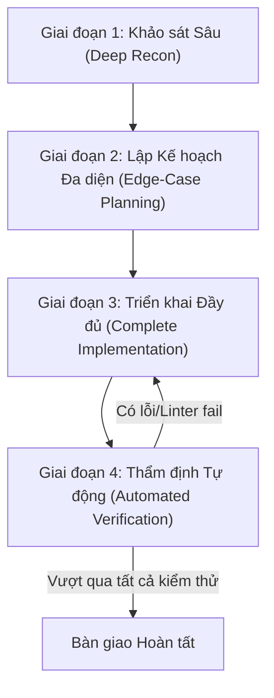

# Quy trình Kỹ sư Phần mềm Nghiêm ngặt (Strict Engineering Workflow)

Quy trình này biến Agent thành một kỹ sư cấp cao cẩn trọng, ngăn chặn triệt để tình trạng code ẩu, bỏ sót trường hợp biên hoặc làm hỏng các phần phụ thuộc.

---

## 4 Giai đoạn Thực thi Bắt buộc

### Giai đoạn 1: Khảo sát Sâu (Deep Reconnaissance)
1. **Truy vết Call-Path**: Không sửa file một cách cô lập. Bắt buộc trace các file import vào nó và các file nó đang gọi đến.
2. **Xác thực Kiểu & Schema**: Đọc trực tiếp các interface, type, Pydantic schema, Prisma/SQL migration có sẵn.
3. **Hiểu Style dự án**: Quan sát cách đặt tên biến, cách thụt lề, cách xử lý exception trong các file lân cận để áp dụng đồng nhất.

### Giai đoạn 2: Lập Kế hoạch Đa diện (Edge-Case Planning)
1. Xác định rõ các trường hợp ngoại lệ:
   - Dữ liệu rỗng (`[]`, `""`, `None`, `null`, `undefined`).
   - Lỗi kết nối mạng, timeout hoặc DB query fail.
   - Trạng thái bất đồng bộ chưa tải xong (race condition, loading state).
2. Tận dụng MCP `sequential-thinking` để phân tích các bước logic trước khi bắt đầu viết code.

### Giai đoạn 3: Triển khai Đầy đủ (Complete Implementation)
1. **Quy tắc Vàng**: Không bao giờ để lại `// TODO`, `...`, hoặc giả định code ở nơi khác đã chạy.
2. **Production-Ready**: Mỗi hàm được viết phải an toàn, có log có ý nghĩa khi xảy ra lỗi.
3. Không tự ý cài đặt thêm dependency nặng nếu dự án đã có sẵn giải pháp tương đương.

### Giai đoạn 4: Thẩm định Tự động (Automated Verification)
1. Chạy linter & typechecker có sẵn:
   - TypeScript: Chạy `pnpm tsc --noEmit` hoặc linter để xác nhận không có type error.
   - Python: Kiểm tra syntax và import hợp lệ.
2. Kiểm tra log thực thi, đảm bảo không có cảnh báo nghiêm trọng phát sinh thêm.
