# 🚗 GreenSM MLOps — Active Learning & Data Engine Platform

<div align="center">


<p align="center">
  <b>Nền tảng MLOps Data Engine khép kín & Vòng lặp Active Learning (HITL) phục vụ bài toán Thị giác máy tính và Xe tự hành thông minh cho GreenSM.</b>
</p>

</div>

---

## 📌 Tổng quan dự án (Project Overview)

Trong các bài toán xe tự hành và thị giác máy tính của **GreenSM**, việc thu thập hàng triệu khung hình video từ camera hành trình dẫn đến chi phí gán nhãn thủ công khổng lồ và độ trễ lớn khi huấn luyện lại mô hình.

**GreenSM MLOps Platform** giải quyết bài toán này bằng cơ chế **Data Engine khép kín (Flywheel Architecture)**:
1. **Lọc dữ liệu thông minh (Data Lab)**: Phát hiện và loại bỏ các khung hình trùng lặp, hình ảnh chất lượng thấp, phân tích phân phối lát cắt dữ liệu (Data Slices).
2. **Khai phá mẫu giá trị cao (Active Mining)**: Sử dụng các thuật toán Uncertainty Sampling kết hợp PCA Dimensionality Reduction để lựa chọn ra top 5% – 10% các mẫu khó nhất, mang lại giá trị thông tin cao nhất cho mô hình.
3. **Gán nhãn tương tác thông minh (HITL Studio & CVAT)**: Tích hợp sâu hai chiều với nền tảng CVAT, đồng bộ hóa dự đoán (Pre-labels) từ mô hình để hỗ trợ gán nhãn viên tăng tốc độ dán nhãn gấp 3 lần, kiểm định độ đồng thuận (Consensus Scoring).
4. **Đánh giá & Benchmark (Model Benchmark)**: Đo lường độ trễ suy luận (Latency Profiling), đánh giá hiệu quả lượng tử hóa (FP16 / INT8), phân tích định lượng ROI trước khi triển khai mô hình lên các thiết bị Edge trên xe.

---

## 🏗️ Kiến trúc hệ thống (System Architecture)

```mermaid
flowchart LR
    subgraph DataSources["1. Data Sources"]
        Cam["Camera Xe GreenSM"] --> Raw["Raw Frames"]
    end

    subgraph DataEngine["2. Data Engine & Active Mining"]
        Raw --> Dedup["Dedup Engine"]
        Dedup --> PCA["PCA Embedding Projector"]
        PCA --> Miner["Uncertainty Scorer"]
        Miner --> TopK["High-value Candidates (Top K)"]
    end

    subgraph HITL["3. Human-in-the-Loop Studio"]
        TopK --> CVAT["CVAT Annotation Tool"]
        CVAT <--> Sync["CVAT Two-way Sync Bridge"]
        Sync --> Consensus["Consensus & Quality Check"]
    end

    subgraph Evaluation["4. Benchmark & Deployment"]
        Consensus --> TrainData["Curated Golden Dataset"]
        TrainData --> Bench["Model Benchmark & Latency Profiler"]
        Bench --> Edge["GreenSM Edge Device Deployment"]
    end
```



---

## ✨ Tính năng cốt lõi (Core Features)

- 🔐 **Enterprise Auth & RBAC**: Hệ thống phân quyền chặt chẽ (`ADMIN`, `ANNOTATOR`, `REVIEWER`), quản lý phiên đăng nhập thiết bị an toàn, xác thực JWT rotation.
- 📁 **Quản trị đa dự án (Projects & Campaigns)**: Tổ chức và theo dõi tiến độ các chiến dịch gán nhãn Active Learning, chỉ định thành viên và tích hợp tự động với tài khoản CVAT cá nhân.
- 🎯 **Active Mining Studio**: Tùy chỉnh trọng số khai phá (Uncertainty, Diversity, Representativeness), biểu đồ phân tán PCA tương tác trực quan thời gian thực.
- 🔬 **Data Lab & Slice Analytics**: Phân tích metadata, lọc theo lát cắt điều kiện môi trường (ban đêm, mưa, sương mù, đường đông đúc) và thống kê tỷ lệ trùng lặp.
- 🏷️ **Tích hợp CVAT liền mạch**: Tự động tạo Task/Job, cấp phát quyền cho annotator và đồng bộ hóa nhãn dán trực tiếp thông qua CVAT REST API.
- ⚡ **Giao diện hiện đại & Mượt mà**: Tối ưu UI/UX với chuẩn VinFast Soft Editorial, kết hợp các thành phần React Bits (SpotlightCard, ShinyText, BlurText, TrueFocus, DecryptedText).

---

## 🛠️ Công nghệ sử dụng (Tech Stack)

### Backend
- **Ngôn ngữ**: Python 3.11+
- **Framework**: FastAPI (Async)
- **Database**: PostgreSQL với SQLAlchemy 2.0 (Async Engine)
- **Object Storage**: MinIO (Tương thích chuẩn AWS S3)
- **Data & ML Libraries**: NumPy, Scikit-learn, OpenCV, Ultralytics YOLO
- **Tích hợp ngoài**: CVAT REST API & Webhooks
- **Logging**: Loguru chuẩn hóa structured logging

### Frontend
- **Framework**: Next.js 14 (App Router)
- **UI Library**: React 18, Tailwind CSS, Lucide React, Framer Motion
- **Interactive UI**: React Bits components (SpotlightCard, BlurText, ShinyText, etc.)
- **State & Data Fetching**: Zustand, SWR / Custom HTTP Hooks
- **Package Manager**: pnpm

### DevOps & Infrastructure
- Docker & Docker Compose
- Nginx Reverse Proxy

---

## 🚀 Hướng dẫn cài đặt & Khởi chạy (Getting Started)

### 1. Yêu cầu hệ thống (Prerequisites)
- [Docker](https://www.docker.com/) & Docker Compose
- [Node.js](https://nodejs.org/) (v18+) & [pnpm](https://pnpm.io/)
- [Python](https://www.python.org/) (v3.11+)

---

### 2. Khởi động các dịch vụ hạ tầng (Docker Compose)
Khởi động PostgreSQL, MinIO Storage và các dịch vụ phụ trợ:

```bash
docker-compose up -d postgres minio
```

---

### 3. Cài đặt & Khởi chạy Backend

```bash
# Di chuyển vào thư mục backend
cd backend

# Tạo và kích hoạt môi trường ảo
python3 -m venv .venv
source .venv/bin/activate  # Trên macOS/Linux
# hoặc: .venv\Scripts\activate trên Windows

# Cài đặt thư viện phụ thuộc
pip install -r requirements.txt

# Tạo file cấu hình môi trường từ mẫu
cp .env.example .env

# Khởi chạy server FastAPI
uvicorn app.main:app --reload --host 0.0.0.0 --port 8000
```

> **API Documentation**: Truy cập Swagger UI tại `http://localhost:8000/docs` hoặc `http://localhost:8000/api/v1/docs`.

---

### 4. Cài đặt & Khởi chạy Frontend

Mở terminal mới:

```bash
# Di chuyển vào thư mục frontend
cd frontend

# Cài đặt thư viện qua pnpm
pnpm install

# Tạo file cấu hình môi trường
cp .env.local.example .env.local

# Khởi chạy Next.js development server
pnpm dev
```

> **Web Application**: Truy cập giao diện tại `http://localhost:3000`.

---

## 📂 Cấu trúc thư mục (Directory Structure)

```text
project-hackathon-greenSM/
├── backend/                  # FastAPI Application
│   ├── app/
│   │   ├── core/             # Database, Config, MinIO, CVAT client, Security
│   │   ├── modules/
│   │   │   ├── auth/         # Xác thực JWT, User Sessions, RBAC
│   │   │   └── projects/     # Quản lý Projects, Campaigns, Tasks, Jobs
│   │   ├── shared/           # Schemas, Exception Handlers, Helpers
│   │   └── main.py           # FastAPI Application Entrypoint
│   ├── tests/                # Automated Backend Unit & Integration Tests
│   ├── Dockerfile            # Containerization cho Backend
│   └── requirements.txt      # Python Dependencies
├── frontend/                 # Next.js 14 Application
│   ├── src/
│   │   ├── app/              # Next.js App Router Pages (login, projects, settings...)
│   │   ├── modules/          # Feature-sliced Modules (auth, projects, data-lab...)
│   │   └── shared/           # Shared UI Components, React Bits, API Clients
│   ├── public/               # Static Assets
│   ├── package.json          # Node Dependencies
│   └── tailwind.config.ts    # Tailwind CSS Configuration
├── docs/                     # Tài liệu thiết kế kiến trúc & API Specifications
│   ├── 01-architecture/      # Sơ đồ kiến trúc & Data Flow
│   ├── 02-data-engine/       # Thuật toán Deduplication & Profiling
│   ├── 03-active-learning/   # Quy trình HITL & Tích hợp CVAT
│   ├── 04-model-benchmarks/  # Benchmark, Quantization & Latency Profiles
│   ├── api-specs/            # Tài liệu đặc tả REST Endpoints
│   └── reports/              # Các báo cáo tổng kết chuyên sâu
├── docker-compose.yml        # Điều phối môi trường phát triển & Production
└── .gitignore                # Danh mục loại trừ bảo mật và tệp tạm
```

---

## 📄 Bản quyền (License)

Dự án được phát triển phục vụ cuộc thi **GreenSM Hackathon**. Mọi quyền được bảo lưu.
