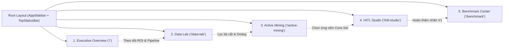

# Đặc Tả Kiến Trúc Frontend: GreenSM HITL Active Learning Studio

- **Dự án**: GreenSM Human-in-the-Loop Active Learning Platform
- **Mã thành phần**: `FRONTEND-NEXTJS-APP`
- **Framework & Ngôn ngữ**: Next.js 15 (App Router, React 19) / TypeScript / Tailwind CSS v3.4 LTS
- **Cập nhật lần cuối**: 09/10/2026

---

## 1. Mục Tiêu Nghiệp Vụ & Trải Nghiệm Người Dùng (UX Principles)

Phân hệ Frontend được xây dựng nhằm cung cấp giao diện làm việc tối ưu cho Kỹ sư MLOps, Chuyên gia QA và Người gán nhãn dữ liệu (Annotator). Thiết kế tuân thủ 3 nguyên tắc trải nghiệm cốt lõi:
1. **Phản hồi tức thì & Siêu mượt (Ultra-Low Latency)**: Bàn làm việc Canvas 2D đạt 60 FPS khi thao tác phóng to, thu nhỏ, dịch chuyển và nắn chỉnh hộp bao (Bounding Box) trên ảnh độ phân giải cao 4K.
2. **Tối thiểu hóa tải nhận thức (Cognitive-Load Reduction)**: Giao diện bàn làm việc HITL phân nhóm ảnh theo lát cắt khó tương đồng, kết hợp hệ thống phím tắt 1 chạm và trợ lý AI tra cứu quy chuẩn tại chỗ.
3. **Minh bạch hóa quá trình học chủ động (Transparent Active Learning)**: Trực quan hóa không gian đặc trưng Deep Embedding trên đồ thị phân tán 2D PCA và thanh trượt điều chỉnh trọng số thời gian thực.

---

## 2. Bản Đồ Không Gian Làm Việc (5 Workspaces Mapping)



### 2.1. Chi Tiết Tính Năng Từng Không Gian

| Workspace & Route | Tính Năng & Thành Phần Trọng Tâm | Công Nghệ & Kỹ Thuật Đặc Thù |
| :--- | :--- | :--- |
| **Executive Overview** (`/`) | Theo dõi tiến độ 4 Phase (10 bước), ma trận khối lượng ảnh qua các tập (Raw, Seed, Test, Val, V1), các chỉ số ROI cốt lõi (Time Saved %, Quality Gain). | Sơ đồ tiến trình phản ứng nhanh, Card thống kê tích hợp real-time SSE. |
| **Data Lab** (`/data-lab`) | Thống kê tỷ lệ cắt giảm trùng lặp pHash BK-Tree (85-95%), bộ lọc phân tích 5 lát cắt khó (Ban đêm, Nhòe mờ, Xe nhỏ xa, Che khuất, Mật độ cao). | Lưới xem trước ảnh phân trang ảo (Virtual Grid), bộ lọc đa tiêu chí HSV/Laplacian. |
| **Active Mining** (`/active-mining`) | Đồ thị phân tán 2D PCA biểu diễn cụm không gian đặc trưng, thanh trượt tinh chỉnh trực tiếp trọng số $U_i, W_i, A_i, E_i$, danh sách ứng viên $k$-Center Greedy. | HTML5 Canvas 2D Context API render >2.000 điểm dữ liệu 60 FPS không giật lag. |
| **HITL Studio** (`/hitl-studio`) | Bàn làm việc gán nhãn chuyên sâu: Canvas 2D zoom mượt, nắn chỉnh 8 anchor points BBox, hiển thị huy hiệu đồng thuận IoU Consensus giữa YOLO11n và RT-DETR, Guideline Copilot Chatbot. | Zustand store quản lý Undo/Redo stack, custom hook lắng nghe phím tắt 1-chạm tốc độ cao. |
| **Benchmark Center** (`/benchmark`) | Bảng ma trận thử nghiệm đối chứng A/B 4 nhánh (Random vs Active vs Ablation vs Bonus), biểu đồ đo đạc tăng tốc suy luận OpenVINO INT8 CPU (>120 FPS). | Bảng so sánh động, biểu đồ trực quan hóa độ trễ Latency/Throughput. |

---

## 3. Cấu Trúc Mã Nguồn Frontend (`frontend/src/`)

Dự án áp dụng mô hình **Feature-Driven Architecture**, gom cụm mã nguồn theo từng phân hệ chức năng:

```text
frontend/src/
├── app/                                       # App Router của Next.js 15
│   ├── layout.tsx                             # Root Layout: Sidebar cố định bên trái, Top Header
│   ├── page.tsx                               # Executive Overview Dashboard
│   ├── globals.css                            # Tailwind directives & bảng mã màu Design Tokens
│   ├── data-lab/
│   │   └── page.tsx                           # Data Lab Workspace
│   ├── active-mining/
│   │   └── page.tsx                           # Active Mining Workspace
│   ├── hitl-studio/
│   │   └── page.tsx                           # HITL Annotation Studio Workspace
│   └── benchmark/
│       └── page.tsx                           # Benchmark Center Workspace
│
├── modules/                                   # Domain Modules (Feature-Driven)
│   ├── data-lab/
│   │   ├── components/
│   │   │   ├── SliceFilterBar.tsx             # Thanh tab 5 lát cắt dữ liệu
│   │   │   ├── SliceMetricCard.tsx            # Thống kê phân bổ tỷ lệ phần trăm
│   │   │   └── ImageGridPreview.tsx           # Lưới hiển thị ảnh kèm metadata tag
│   │   └── types/index.ts
│   │
│   ├── active-mining/
│   │   ├── components/
│   │   │   ├── PcaScatterPlot.tsx             # Canvas 2D vẽ biểu đồ phân tán PCA
│   │   │   ├── WeightSliderPanel.tsx          # Bảng điều khiển trọng số U, W, A, E
│   │   │   └── CandidateList.tsx              # Danh sách Top-K mẫu được chọn
│   │   └── types/index.ts
│   │
│   ├── hitl-studio/
│   │   ├── components/
│   │   │   ├── CanvasEngine.tsx               # Bàn vẽ Canvas 2D gán nhãn cốt lõi
│   │   │   ├── LabelToolbar.tsx               # Thanh công cụ chọn 5 classes
│   │   │   ├── ConsensusBadge.tsx             # Huy hiệu cảnh báo độ đồng thuận IoU
│   │   │   └── GuidelineChat.tsx              # Khung chat hỗ trợ tra cứu quy chuẩn
│   │   ├── hooks/
│   │   │   ├── useCanvasTransform.ts          # Logic phóng to con lăn, kéo chuột pan
│   │   │   └── useHotkeys.ts                  # Bộ lắng nghe phím tắt tốc độ cao
│   │   ├── store/
│   │   │   └── hitlStore.ts                   # Zustand Store: danh sách BBox, Undo/Redo
│   │   └── types/index.ts
│   │
│   └── benchmarks/
│       ├── components/
│       │   ├── MatrixTable.tsx                # Bảng ma trận A/B Test 4 nhánh
│       │   └── LatencyChart.tsx               # Biểu đồ so sánh FPS CPU OpenVINO
│       └── types/index.ts
│
└── shared/                                    # Thành phần hạ tầng dùng chung
    ├── components/
    │   ├── layout/
    │   │   ├── AppSidebar.tsx                 # Thanh điều hướng 5 workspaces
    │   │   └── TopHeader.tsx                  # Hiển thị trạng thái kết nối backend
    │   └── ui/                                # Thư viện nút bấm, card, modal, badge
    ├── hooks/
    │   └── useSSE.ts                          # Hook kết nối Server-Sent Events backend
    └── lib/
        ├── api.ts                             # Client HTTP Axios / Fetch bọc token
        └── utils.ts                           # Hàm tiện ích tính tọa độ, format số
```

---

## 4. Bàn Làm Việc Gán Nhãn Đạt 60 FPS (HITL Canvas Engine)

### 4.1. Kỹ Thuật Render Canvas 2D Hiệu Năng Cao
- **Không sử dụng thư viện cồng kềnh**: Bàn vẽ được viết trực tiếp trên HTML5 Canvas 2D Context API thuần, tận dụng `requestAnimationFrame` và kỹ thuật Double Buffering để triệt tiêu hiện tượng xé hình (tearing).
- **Phép biến hình Tọa độ (Coordinate Transformation)**: Hệ thống duy trì ma trận biến đổi tọa độ $2 \times 3$ (Zoom Scale, Pan Offset X/Y) cho phép chuyển đổi 2 chiều chính xác giữa tọa độ con trỏ màn hình (Screen Coordinates) và tọa độ pixel gốc của ảnh (Image Coordinates):
  $$\begin{cases} X_{img} = \frac{X_{screen} - \text{offsetX}}{\text{scale}} \\ Y_{img} = \frac{Y_{screen} - \text{offsetY}}{\text{scale}} \end{cases}$$
- **Nắn chỉnh 8 Anchor Points**: Bounding Box được hiển thị kèm 8 điểm neo tại 4 góc và 4 cạnh giữa, hỗ trợ kéo giãn đa chiều với dung sai bắt dính chuột 6px.

### 4.2. Hệ Thống Phím Tắt 1 Chạm Tốc Độ Cao (1-Key Hotkeys)
Để tối ưu hóa thời gian từ 90 giây xuống dưới 15 giây/ảnh cho người gán nhãn, hệ thống trang bị bộ phím tắt phản xạ nhanh:
- `Space`: Xác nhận hoàn thành ảnh hiện tại, lưu nhãn vào cơ sở dữ liệu và tự động chuyển sang ảnh tiếp theo.
- `G`: Đổi nhãn của BBox đang chọn thành `greensm` (màu xanh Cyan).
- `C`: Đổi nhãn của BBox đang chọn thành `car` (màu xanh dương).
- `M`: Đổi nhãn của BBox đang chọn thành `motorcycle` (màu vàng cam).
- `B`: Đổi nhãn của BBox đang chọn thành `bus` (màu tím).
- `T`: Đổi nhãn của BBox đang chọn thành `truck` (màu đỏ).
- `Delete` hoặc `Backspace`: Xóa bỏ BBox rác đang được chọn.
- `Ctrl + Z` / `Cmd + Z`: Hoàn tác thao tác vừa thực hiện (Undo).
- `Ctrl + Shift + Z` / `Cmd + Shift + Z`: Phục hồi thao tác vừa hoàn tác (Redo).

### 4.3. Huy Hiệu Đồng Thuận (IoU Consensus Badge) & RAG Copilot
- **Consensus Badge**: Khi một ảnh được nạp vào bàn vẽ, hệ thống so sánh cặp BBox dự đoán từ YOLO11n và RT-DETR:
  - Nếu $IoU \ge 0.90$ & Cùng nhãn: Hiển thị badge xanh lá `High Consensus (Tier 1 Ready)`.
  - Nếu $IoU < 0.90$ hoặc lệch nhãn: Hiển thị badge cam `Disagreement Zone (Human Attention Required)`.
- **RAG Copilot Chatbot**: Ngăn kéo bên phải tích hợp trợ lý chat thông minh được nạp sẵn quy chuẩn gán nhãn từ [Annotation Guidelines](file:///Users/huynh/projects/h20k_vinuni/lv2-3/projects/project-hackathon-greenSM/docs/02-data-engine/taxonomy-and-guidelines.md), giúp annotator hỏi nhanh các tình huống ranh giới (ví dụ: *"Xe màu xanh ngọc của người dân có gán greensm không?"* -> Trợ lý trả lời ngay *"Không, chỉ gán nhãn car"*).
