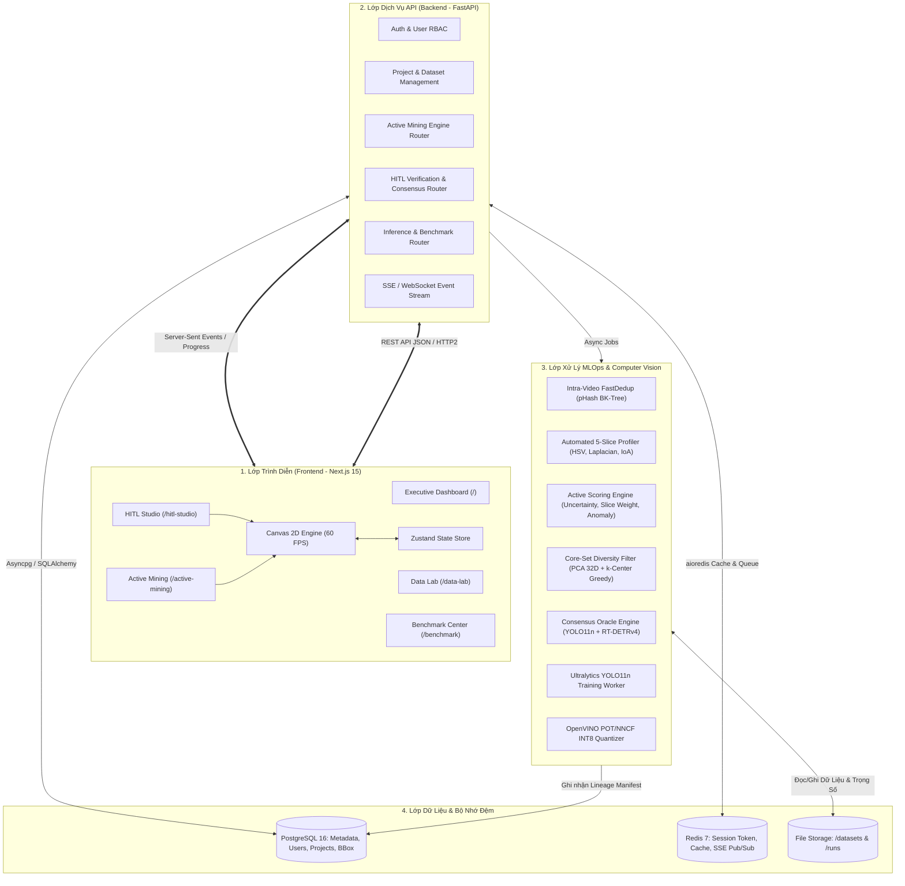

# Kiến Trúc Hệ Thống Tổng Thể: GreenSM HITL Active Learning Platform

- **Dự án**: GreenSM Human-in-the-Loop Active Learning Platform
- **Mã hệ thống**: `GREENSM-HITL-M50`
- **Phiên bản kiến trúc**: V3.0 Enterprise Ready
- **Cập nhật lần cuối**: 09/10/2026

---

## 1. Tổng Quan Kiến Trúc & Bối Cảnh Nghiệp Vụ

Hệ thống **GreenSM HITL Active Learning Platform** là một nền tảng MLOps khép kín (End-to-End Active Learning & Data-Centric AI Platform), được thiết kế nhằm giải quyết bài toán phát hiện và phân loại phương tiện giao thông hỗn hợp tại Việt Nam, tập trung chuyên sâu vào phương tiện xe điện taxi **GreenSM** (`greensm`).

### 1.1. Mục Tiêu Kỹ Thuật & Giá Trị Thương Mại
- **Tối ưu hóa ngân sách gán nhãn**: Thay vì gán nhãn toàn bộ kho dữ liệu lớn hàng chục ngàn ảnh một cách thủ công tốn kém, hệ thống kết hợp thuật toán **Active Mining (Cost-Aware)** cùng cơ chế **Two-Tier Human-in-the-Loop (HITL)** để chọn đúng 10–20% lượng ảnh mang lại giá trị huấn luyện cao nhất.
- **Triển khai biên thực tế (Edge-Ready Deployment)**: Mô hình đích **YOLO11n** siêu nhẹ (5.5 MB) đạt tốc độ trên 110 FPS trên GPU và sau khi nén **OpenVINO INT8** đạt >120 FPS trên vi xử lý Intel CPU thông thường, phục vụ trực tiếp cho camera giám sát giao thông đô thị và thiết bị trên xe taxi.
- **Ứng dụng thương mại (EV Fleet Operations & OOH Analytics)**: Giám sát mật độ phân bổ đội xe GreenSM theo thời gian thực tại các nút giao thông, sân bay, trung tâm thương mại và phân tích thị phần thương hiệu ngoài trời so với taxi truyền thống và xe công nghệ khác.

---

## 2. Sơ Đồ Kiến Trúc Toàn Hệ Thống (End-to-End Architecture)

Hệ thống tuân thủ kiến trúc Monorepo phân lớp chặt chẽ, kết hợp xử lý bất đồng bộ thời gian thực:



---

## 3. Cấu Trúc Mã Nguồn Monorepo

Toàn bộ dự án được tổ chức tại thư mục gốc như sau:

```text
project-hackathon-greenSM/
├── backend/                             # Dịch vụ backend FastAPI chuẩn Clean Architecture
│   ├── app/
│   │   ├── core/                        # Cấu hình, database, bảo mật JWT, logger, SSE/WebSocket
│   │   ├── modules/                     # Phân rã domain: auth, projects, datasets, mining, hitl
│   │   ├── shared/                      # Schemas, utils, custom exceptions dùng chung
│   │   └── main.py                      # FastAPI Application entrypoint & CORS middleware
│   ├── requirements.txt                 # Thư viện Python (FastAPI, PyTorch, Ultralytics, OpenVINO, OpenCV)
│   └── Dockerfile                       # Container hóa môi trường chạy backend
│
├── frontend/                            # Giao diện người dùng Next.js 15 (App Router, Tailwind CSS)
│   ├── src/
│   │   ├── app/                         # Định tuyến 5 workspaces chính
│   │   ├── modules/                     # Feature modules: data-lab, active-mining, hitl-studio, benchmark
│   │   └── shared/                      # UI primitives, hooks (Canvas transform, Hotkeys), layout
│   ├── package.json                     # Quản lý dependencies (pnpm)
│   └── Dockerfile                       # Multi-stage build cho Next.js dev & production
│
├── datasets/                            # Kho lưu trữ ảnh và nhãn chuẩn hóa
│   ├── raw/                             # Ảnh/video thô thu thập từ camera giao thông
│   ├── fixed_test/                      # Tập kiểm thử bất biến (160 ảnh, Dual-Freeze SHA-256)
│   ├── fixed_val/                       # Tập kiểm định bất biến (40 ảnh, Dual-Freeze SHA-256)
│   ├── seed_v0/                         # Tập khởi tạo mầm (250 ảnh)
│   └── active_v1/                       # Tập dữ liệu khai thác V1 (Tier 1 + Tier 2)
│
├── runs/                                # Kết quả huấn luyện và kiểm định mô hình
│   ├── train/v0/                        # Checkpoint & metrics Model V0
│   ├── train/v1/                        # Checkpoint & metrics Model V1
│   └── benchmarks/                      # Báo cáo JSON latency CPU OpenVINO & A/B Matrix
│
├── docs/                                # Hệ thống tài liệu kỹ thuật doanh nghiệp chuẩn hóa
├── docker-compose.yml                   # Tự động hóa điều phối 5 containers (Postgres, Redis, API, UI, Adminer)
└── v4.md                                # Bản đặc tả kỹ thuật gốc làm mốc đối chứng
```

---

## 4. Ngăn Xếp Công Nghệ Chuẩn Hóa (Technology Stack)

| Thành Phần | Công Nghệ Lựa Chọn | Phiên Bản | Vai Trò & Rationale |
| :--- | :--- | :---: | :--- |
| **Giao Diện (Frontend)** | Next.js (React 19) | 15.x | SSR kết hợp App Router cho hiệu năng tải ban đầu và định tuyến mượt mà. |
| **Styling** | Tailwind CSS + CSS Variables | 3.4 LTS | Giao diện tối ưu dark mode, bảng điều khiển kỹ thuật sắc nét, tải trang nhẹ. |
| **Canvas Engine** | HTML5 Canvas 2D API thuần | Pure JS | Render mượt mà 60 FPS cho bàn gán nhãn HITL và đồ thị phân tán PCA 2.000+ điểm. |
| **Client State** | Zustand | 4.5+ | Quản lý state cục bộ cho BBox manipulation, Undo/Redo stack, không re-render thừa. |
| **Dịch Vụ API** | FastAPI (Python) | 0.115+ | Hiệu năng cao (Asynchronous), tự sinh OpenAPI schema, tích hợp mượt với PyTorch. |
| **Cơ Sở Dữ Liệu** | PostgreSQL + asyncpg | 16-alpine | Lưu trữ ACID dữ liệu người dùng, dự án, annotation metadata, audit lineage logs. |
| **Bộ Nhớ Đệm & Queue** | Redis | 7-alpine | Quản lý token session, rate limiting, pub/sub SSE truyền dữ liệu theo thời gian thực. |
| **Mô Hình Lõi (Edge)** | YOLO11n (Ultralytics) | SOTA 2026 | Dung lượng 5.5 MB, tốc độ >110 FPS, kiến trúc CNN tối ưu nhận diện xe nhỏ. |
| **Mô Hình Thẩm Định (Oracle)** | RT-DETRv4 (Baidu/Ultralytics) | SOTA 2026 | Dung lượng ~65 MB, cơ chế Transformer Global Attention giải quyết triệt để ca che khuất. |
| **Tối Ưu Biên (Inference)** | OpenVINO Runtime + NNCF | 2024.x | Lượng tử hóa Post-Training INT8 đạt >120 FPS trên Intel CPU mà không hao hụt mAP. |
| **Điều Phối Hạ Tầng** | Docker & Docker Compose | v2+ | Đóng gói môi trường đồng nhất giữa macOS (Apple Silicon) và máy chủ Linux. |

---

## 5. Luồng Dữ Liệu Khép Kín (Closed-Loop Data Flow)

Hệ thống vận hành theo quy trình vòng tròn dữ liệu khép kín (Data Flywheel):
1. **Tiếp nhận & Lọc dữ liệu thô**: Dữ liệu video camera giao thông được đẩy vào luồng trích xuất 1 FPS, khử trùng lặp qua thuật toán [pHash BK-Tree](file:///Users/huynh/projects/h20k_vinuni/lv2-3/projects/project-hackathon-greenSM/docs/02-data-engine/deduplication-and-profiling.md), ưu tiên giữ khung hình đông xe.
2. **Khai thác ứng viên khó**: Mô hình V0 suy luận trên kho Unlabeled Pool, thuật toán [Active Mining](file:///Users/huynh/projects/h20k_vinuni/lv2-3/projects/project-hackathon-greenSM/docs/03-active-learning-hitl/active-mining-core.md) tính điểm bất định $U_i$, trọng số lát cắt $W_i$, độ bất thường $A_i$ và trừ phạt công sức $E_i$.
3. **Đa dạng hóa mẫu (Core-Set)**: Trích xuất embedding 512D từ backbone YOLO11n, chiếu giảm chiều PCA 32D và lọc bằng thuật toán $k$-Center Greedy để chọn ra 200 mẫu đặc sắc nhất.
4. **Phân luồng 2 tầng HITL**:
   - **Tier 1 (Tự động duyệt)**: Cặp đôi YOLO11n và RT-DETR đạt đồng thuận $IoU \ge 0.90$ và $Conf \ge 0.85$ (ngoại trừ các ca ban đêm và xe nhỏ).
   - **Tier 2 (Con người tinh chỉnh)**: Các ca ranh giới bất đồng và lát cắt khó được chuyển vào bàn làm việc [HITL Studio](file:///Users/huynh/projects/h20k_vinuni/lv2-3/projects/project-hackathon-greenSM/docs/01-architecture/frontend-architecture.md) với phím tắt 1-chạm và trợ lý tra cứu quy chuẩn.
5. **Ghi log kiểm toán & Huấn luyện lại**: Xuất thẻ căn cước dữ liệu `manifest.yaml`, niêm phong SHA-256, huấn luyện ra Model V1 và kiểm định ý nghĩa thống kê trên tập kiểm thử bất biến [Fixed Test Set](file:///Users/huynh/projects/h20k_vinuni/lv2-3/projects/project-hackathon-greenSM/docs/02-data-engine/dataset-splits-and-freeze.md).
