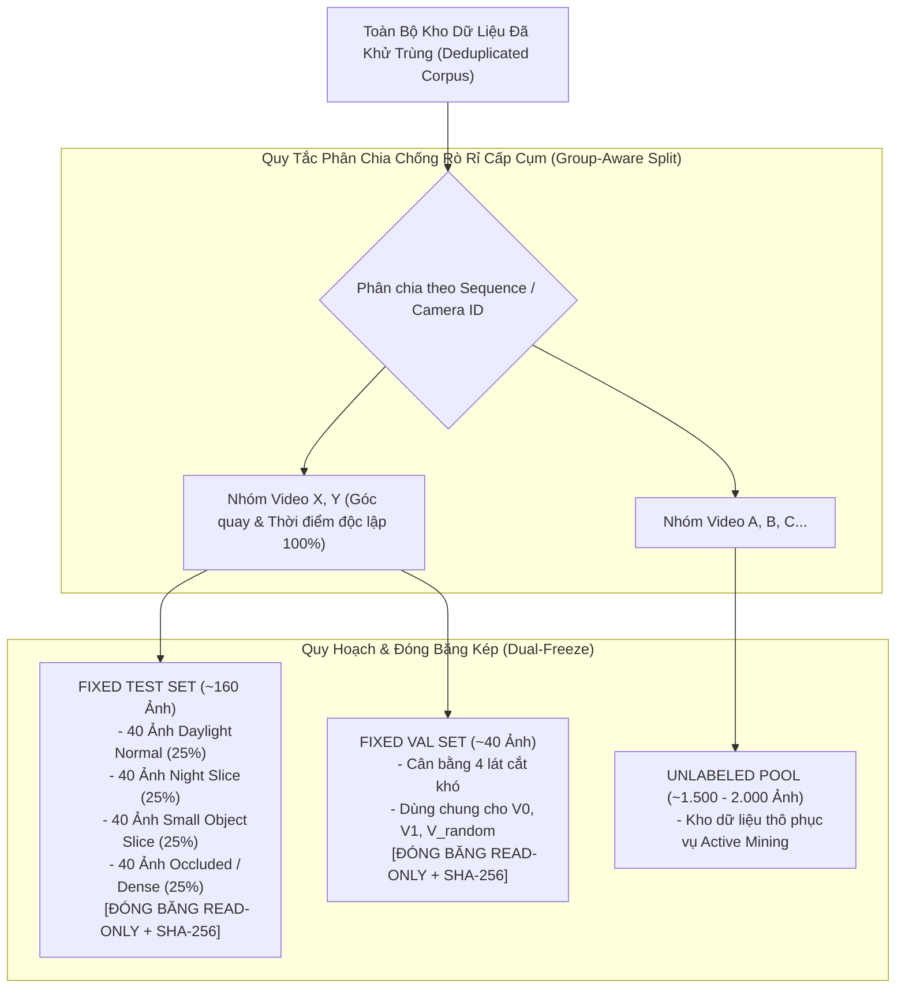

# Phân Chia Tập Dữ Liệu Chống Rò Rỉ & Đóng Băng Kép (Dataset Splits & Dual-Freeze)

- **Dự án**: GreenSM Human-in-the-Loop Active Learning Platform
- **Mã quy trình**: `PIPELINE-STEP-03`
- **Phiên bản**: V3.0 Final
- **Cập nhật lần cuối**: 09/10/2026

---

## 1. Nguyên Tắc Phân Chia Dữ Liệu Chống Rò Rỉ (Anti-Leakage Group Split)

Tập kiểm thử (Test Set) là "thước đo chân lý" độc lập tối thượng của dự án. Mọi sai lệch hoặc hiện tượng rò rỉ dữ liệu giữa tập huấn luyện và tập kiểm thử sẽ làm vô hiệu hóa hoàn toàn tính khoa học của kết quả thử nghiệm.



### 1.1. Cơ Chế Chống Rò Rỉ Cấp Cụm (Group-Aware Split)
1. **Đối với Luồng Video**: 
   - Phân chia dựa trên `Video Sequence ID` và `Camera ID`. 
   - **Tuyệt đối cấm phân chia ngẫu nhiên cấp khung hình (Frame-level random split)**: Toàn bộ các khung hình trích xuất từ cùng một video hoặc cùng một vị trí camera phải nằm trọn vẹn ở tập Train hoặc tập Test/Val. Việc frame $t$ ở Train và frame $t+1$ ở Test sẽ khiến mô hình "nhìn trộm" góc máy, màu sắc đèn đường và dáng xe, dẫn đến mAP ảo cao nhưng mô hình mất khả năng tổng quát hóa ngoài thực địa.
2. **Đối với Luồng Ảnh rời**:
   - Gom cụm ảnh theo địa điểm chụp và dải thời gian EXIF để cách ly hoàn toàn cụm ảnh thử nghiệm khỏi cụm ảnh huấn luyện.

---

## 2. Thiết Kế Tập Kiểm Thử Thử Thách Cân Bằng (Balanced Stress-Test)

Thay vì giữ tỷ lệ xuất hiện tự nhiên ngoài đời (nơi ban ngày chiếm >80% và xe lớn ở gần chiếm đa số), tập **Fixed Test Set** được thiết kế thành một bài kiểm tra áp lực cao (**Stress-Test**) với tỷ lệ cân bằng đều 4 lát cắt khó:

| Lát Cắt Kiểm Thử | Số Lượng Mẫu | Tỷ Lệ (%) | Mục Tiêu Khảo Sát & Đo Lường |
| :--- | :---: | :---: | :--- |
| **1. Daylight Normal** | ~40 ảnh | 25% | Đo lường độ chính xác cơ sở trong điều kiện ánh sáng lý tưởng ban ngày. |
| **2. Night Slice** | ~40 ảnh | 25% | Khảo sát lỗi nhận diện màu xanh Cyan đặc trưng của GreenSM khi bị ám vàng dưới đèn cao áp. |
| **3. Small Object Slice** | ~40 ảnh | 25% | Đo năng lực phát hiện phương tiện ở cự ly xa ($< 32 \times 32\text{px}$) từ góc nhìn camera tầm cao. |
| **4. High Occlusion / Dense** | ~40 ảnh | 25% | Khảo sát năng lực bóc tách thân xe GreenSM khi bị chen lấn, che lấp $> 30\%$ bởi dòng xe máy đông đúc. |
| **TỔNG CỘNG** | **160 ảnh** | **100%** | **Thước đo ground truth đánh giá A/B Testing & Báo cáo ROI** |

---

## 3. Giao Thức Đóng Băng Kép (Dual-Freeze Protocol)

Hệ thống thiết lập 2 tập dữ liệu độc lập và tiến hành khóa cứng trạng thái (Read-Only):

### 3.1. Phân Biệt Giữa Fixed Test Set & Fixed Val Set
- **Fixed Test Set (~160 ảnh)**: Dùng **ĐỘC QUYỀN** cho khâu nghiệm thu cuối cùng (Final Evaluation), xuất ma trận Recall lát cắt và tính toán các chỉ số cải thiện chất lượng mô hình ($\Delta mAP, \Delta Recall$). Tập này tuyệt đối không được cấp phát cho bất kỳ tiến trình huấn luyện nào truy cập.
- **Fixed Val Set (~40 ảnh)**: Dùng **CHUNG** cho toàn bộ các vòng lặp huấn luyện ($V_0, V_1, V_{\text{random}}, V_{\text{ablation}}$) để YOLO tính toán chỉ số sau mỗi epoch, phục vụ cơ chế Early Stopping và lưu checkpoint tối ưu `best.pt`.
- *Nguyên tắc bảo vệ*: Tuyệt đối không dùng Fixed Test Set làm tập Validation để tránh hiện tượng rò rỉ tối ưu siêu tham số (Hyperparameter Overfitting).

### 3.2. Niêm Phong Bằng Mã Băm SHA-256 & Git Tag
Ngay sau khi quá trình gán nhãn và nghiệm thu hoàn tất bởi QA Lead:
1. Hệ thống tính toán mã băm SHA-256 toàn vẹn cho từng tệp ảnh và tệp nhãn `.txt` tương ứng:
   ```bash
   sha256sum datasets/fixed_test/images/* > datasets/fixed_test/checksums.sha256
   sha256sum datasets/fixed_val/images/* > datasets/fixed_val/checksums.sha256
   ```
2. Đóng dấu phiên bản trên Git:
   ```bash
   git tag -a v1.0-fixed-eval-freeze -m "Freeze Fixed Test & Val Sets for Benchmark Reproducibility"
   git push origin v1.0-fixed-eval-freeze
   ```
3. Khóa quyền ghi tập tin trên hệ điều hành (`chmod -R 555 datasets/fixed_test datasets/fixed_val`), bảo đảm không có bất kỳ dòng lệnh nào có thể vô tình sửa đổi nhãn kiểm thử.
