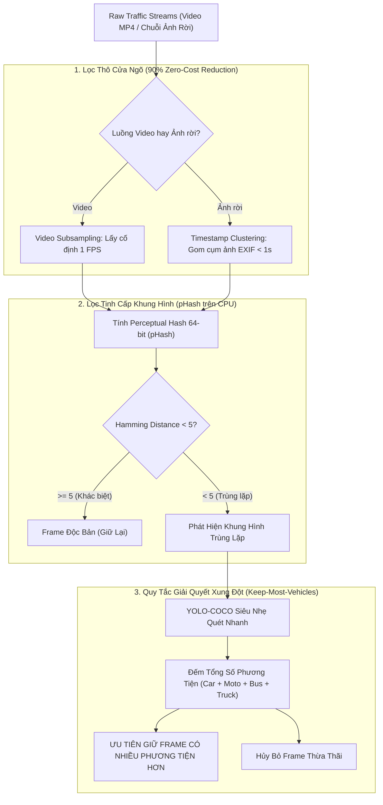
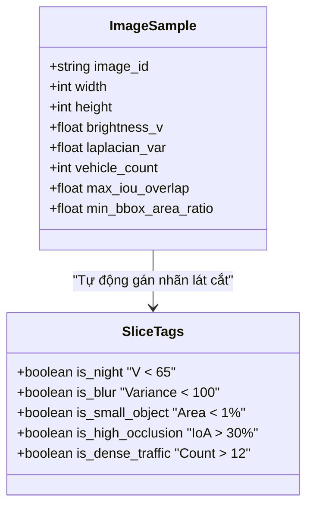

# Lọc Trùng Lặp & Phân Tích Dữ Liệu Tự Động (Deduplication & Profiling)

- **Dự án**: GreenSM Human-in-the-Loop Active Learning Platform
- **Mã quy trình**: `PIPELINE-STEP-01-02`
- **Phiên bản**: V3.0 Final
- **Cập nhật lần cuối**: 09/10/2026

---

## 1. Bước 1 — Dual-Stream Fast Deduplication (Lọc Trùng Lặp Siêu Tốc 2 Luồng)

### 1.1. Vấn Đề Cốt Lõi Trong Dữ Liệu Camera Giao Thông
Khi thu thập video giám sát giao thông tại Việt Nam (đặc biệt trong các khung giờ cao điểm kẹt xe), hàng ngàn khung hình liên tiếp chụp lại cùng một bối cảnh gần như tĩnh. Nếu đưa trực tiếp toàn bộ dữ liệu này vào quy trình gán nhãn:
- **Lãng phí ngân sách nghiêm trọng**: Con người phải tốn hàng trăm giờ công vô ích để vẽ các hộp bao giống hệt nhau trên các ảnh chỉ xê dịch vài milimet.
- **Học vẹt bối cảnh (Overfitting)**: Mô hình học quá đà nền đường và góc camera cố định thay vì học đặc trưng của phương tiện di động.

### 1.2. Giải Pháp Cốt Lõi: Bộ Lọc 2 Màng Kết Hợp Quy Tắc Keep-Most-Vehicles

1. **Lọc Thô (Coarse Subsampling)**:
   - *Luồng Video*: Trích xuất frame ở tần số **1 FPS** (bỏ qua 24–29 fps trùng lặp tự nhiên).
   - *Luồng Ảnh rời*: Nhóm các ảnh chụp liên tiếp (Burst Mode) có dấu thời gian EXIF chênh lệch dưới 1 giây.
2. **Lọc Tinh (CPU-based Perceptual Hash)**:
   - Chuyển ảnh về ảnh xám kích thước $32 \times 32$, áp dụng biến đổi Cosine rời rạc (DCT) và giữ lại ma trận tần số thấp $8 \times 8$ để tạo mã băm nhị phân 64-bit.
   - So sánh khoảng cách Hamming ($HD$): Nếu $HD < 5$, hai bức ảnh được xác định là trùng lặp bối cảnh.
3. **Quy Tắc Đột Phá: Keep-Most-Vehicles**:
   - Thay vì vứt bỏ ngẫu nhiên 1 trong 2 frame trùng lặp, hệ thống dùng **YOLO-COCO siêu nhẹ** đếm tổng số phương tiện (`car`, `motorcycle`, `bus`, `truck`).
   - **Quyết định**: Giữ lại bức ảnh có số lượng phương tiện lớn hơn để tối đa hóa bối cảnh học tập và phát hiện xe nhỏ; hủy bỏ bức ảnh ít xe hơn.
- **Hiệu quả thực nghiệm**: Cắt giảm **85% – 95%** dung lượng dữ liệu rác ngay từ cửa vào mà không làm thất thoát các tình huống giao thông phức tạp.

---

## 2. Bước 2 — Automated Data Profiling & CVAT Time Baseline

### 2.1. Tự Động Trích Xuất Metadata 5 Lát Cắt Khó (Automated Profiler)
Hệ thống sử dụng các thuật toán thị giác máy tính nhẹ chạy tự động để gán tag phân loại cho từng bức ảnh:

1. **Lát cắt Ban đêm (`Night`)**:
   - Chuyển đổi không gian màu RGB sang HSV.
   - Tính giá trị trung bình kênh sáng $V$ (Value):
     $$\text{Brightness} = \frac{1}{H \times W} \sum_{x, y} V(x, y)$$
   - Điều kiện: $\text{Brightness} < 65 \implies \text{Tag: Night}$.
2. **Lát cắt Nhòe mờ (`Blur`)**:
   - Tính phương sai của toán tử đạo hàm bậc hai Laplacian:
     $$\text{Score}_{blur} = \text{Var}(\nabla^2 I)$$
   - Điều kiện: $\text{Score}_{blur} < 100 \implies \text{Tag: Blur}$ (rung lắc camera, trời mưa mờ kính).
3. **Lát cắt Xe nhỏ ở cự ly xa (`Small_Object`)**:
   - Quét diện tích tương đối của BBox so với toàn khung hình:
     $$\text{Area Ratio} = \frac{\text{Width}_{box} \times \text{Height}_{box}}{\text{Width}_{img} \times \text{Height}_{img}}$$
   - Điều kiện: $\text{Area Ratio} < 1\% \text{ và } \text{Kích thước} < 32\times32\text{px} \implies \text{Tag: Small_Object}$.
4. **Lát cắt Che khuất một phần (`High_Occlusion`)**:
   - Tính tỷ lệ diện tích bị đè lấp (Intersection over Area - IoA) giữa các hộp bao phương tiện:
     $$\text{IoA} = \frac{\text{Area}(B_1 \cap B_2)}{\min(\text{Area}(B_1), \text{Area}(B_2))}$$
   - Điều kiện: $\text{IoA} > 30\% \implies \text{Tag: High_Occlusion}$.
5. **Lát cắt Mật độ giao thông cao (`Dense_Traffic`)**:
   - Đếm tổng số lượng phương tiện có trong ảnh: $\sum \text{Vehicles} > 12 \implies \text{Tag: Dense_Traffic}$.

---

## 3. Đo Đạc Mốc Chuẩn Thời Gian Thực Nghiệm (CVAT Measuring Baseline)

Để chứng minh khoa học chỉ số tiết kiệm công sức lao động (Labor Efficiency ROI), hệ thống thực hiện đo đạc mốc chuẩn thực nghiệm (A/B Time Trial) trên cùng một nhóm 50 bức ảnh đại diện:

### 3.1. Phương Pháp Đo
- **Thử nghiệm A — Gán tay thuần túy ($T_{manual}$)**: Người gán nhãn tự quan sát ảnh trắng, tự kéo BBox, tự chọn class từ đầu trên nền tảng CVAT.
  - Kết quả đo đạc trung bình: **$T_{manual} \approx 45 - 90 \text{ giây/ảnh}$** (trung bình $75\text{s}$).
- **Thử nghiệm B — Sửa nhãn mồi hỗ trợ ($T_{assisted}$)**: Người gán nhãn nhận diện ảnh đã có sẵn nhãn mồi (Pre-label) từ AI, chỉ việc căn chỉnh viền BBox, bấm phím tắt 1-chạm `G` để đổi thành `greensm` hoặc bấm `Delete` để xóa box thừa.
  - Kết quả đo đạc trung bình: **$T_{assisted} \approx 15 - 25 \text{ giây/ảnh}$** (trung bình $20\text{s}$).

### 3.2. Công Thức Đo Lường ROI Tiết Kiệm Thời Gian
$$\text{Time Saved \%} = 100\% \times \left(1 - \frac{T_{assisted}}{T_{manual}}\right) = 100\% \times \left(1 - \frac{20}{75}\right) \approx \mathbf{73.3\%}$$

> [!TIP]
> Tỷ lệ $T_{manual} / T_{assisted}$ chính là bằng chứng thực nghiệm quan trọng được tích hợp vào báo cáo nghiệm thu ROI nhằm khẳng định tính vượt trội của quy trình Active Learning HITL so với phương pháp thu thập dữ liệu truyền thống.
