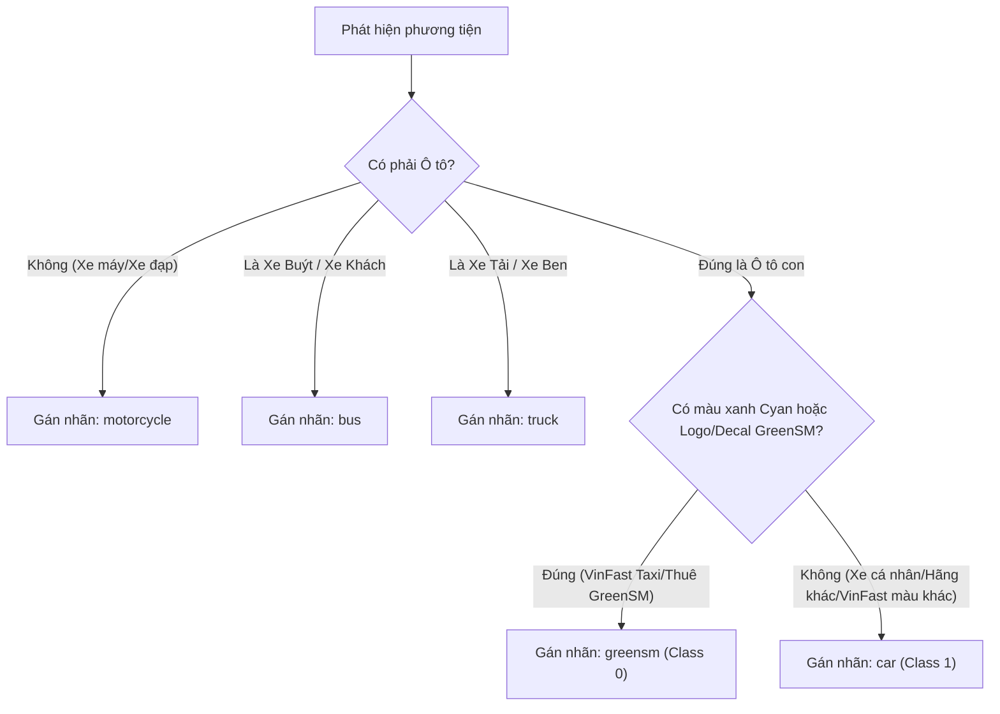

# Quy Chuẩn Danh Mục Nhãn & Hướng Dẫn Gán Nhãn (Taxonomy & Guidelines)

- **Dự án**: GreenSM Human-in-the-Loop Active Learning Platform
- **Mã tài liệu**: `DATA-TAXONOMY-GUIDELINES-V3`
- **Phiên bản**: V3.0 Final (Mentor-Aligned & Enterprise-Ready)
- **Cập nhật lần cuối**: 09/10/2026

---

## 1. Mục Tiêu & Danh Mục Đối Tượng Phân Loại (Label Taxonomy)

Quy chuẩn gán nhãn được xây dựng nhằm chuẩn hóa quá trình nhận diện phương tiện giao thông hỗn hợp tại Việt Nam, tập trung trọng tâm vào việc phân biệt chính xác dòng xe điện **GreenSM** khỏi tất cả các phương tiện ô tô và xe máy khác trong dòng giao thông đô thị.

### 1.1. Bảng Danh Mục 5 Classes Chuẩn Hóa

| Class ID | Tên Nhãn (`class_name`) | Màu Đại Diện | Định Nghĩa & Đặc Trưng Nhận Diện Trọng Tâm | Ý Nghĩa Trong Mô Hình & Nghiệp Vụ |
| :---: | :--- | :---: | :--- | :--- |
| **0** | `greensm` | **Xanh Cyan** (`#00E5FF`) | **Chỉ dành riêng cho Ô tô điện GreenSM**: Các dòng xe VinFast (VF e34, VF 5 Plus, VF 8, VF 9, Minicar VF 3 Taxi) sơn màu xanh Cyan đặc trưng hoặc mang logo/decal thương hiệu GreenSM / Xanh SM. | **TRỌNG TÂM DUY NHẤT**: Tối ưu Precision và Recall cao nhất. Tuyệt đối không được bỏ sót xe taxi điện. |
| **1** | `car` | **Xanh Dương** (`#2979FF`) | **Toàn bộ ô tô con khác**: Taxi truyền thống (Mai Linh, Vinasun), ô tô công nghệ (GrabCar, BeCar), ô tô cá nhân (kể cả ô tô VinFast cá nhân sơn màu đen, trắng, đỏ...). | **Đối chứng thị phần**: Đóng vai trò mẫu số để tính tỷ lệ thị phần đội xe và giúp mô hình học cách phân biệt xe GreenSM với các xe màu xanh khác. |
| **2** | `motorcycle` | **Vàng Cam** (`#FF9100`) | **Toàn bộ xe máy 2 bánh / 3 bánh**: Xe máy số, xe tay ga, xe ôm công nghệ (Grab, Be, Gojek), và **bao gồm cả xe máy điện Xanh SM Bike**. | **Bối cảnh & Che khuất**: Đại diện cho dòng phương tiện đông đúc gây che khuất tầm nhìn chính tại đường phố Việt Nam. |
| **3** | `bus` | **Tím** (`#D500F9`) | **Xe buýt & Xe khách lớn**: Xe buýt nội đô (kể cả VinBus điện), xe khách liên tỉnh từ 16 chỗ trở lên. | **Phương tiện công cộng**: Nhận diện vật thể lớn trong dòng giao thông. |
| **4** | `truck` | **Đỏ** (`#FF1744`) | **Xe tải & Xe chuyên dụng**: Xe tải thùng, xe ben, xe bồn, xe đầu kéo container, xe cứu hỏa. | **Vật cản kích thước lớn**: Bóc tách vật cản tầm nhìn có khối tích lớn. |

> [!IMPORTANT]
> **Quy tắc phân biệt then chốt đối với xe hai bánh:**
> Nhãn `greensm` **CHỈ ÁP DỤNG CHO Ô TÔ**. Toàn bộ xe máy điện VinFast Feliz/Evo mang biển số hoặc màu sơn Xanh SM Bike **BẮT BUỘC gán nhãn là `motorcycle`**. Điều này nhằm đảm bảo bài toán tập trung giải quyết bài toán giám sát đội xe ô tô taxi điện thương mại.

---

## 2. Tiêu Chuẩn Kỹ Thuật Vẽ Hộp Bao (Bounding Box Rules)

Để đảm bảo chất lượng nhãn đạt chuẩn vàng làm thước đo ground truth, người gán nhãn và mô hình tự động phải tuân thủ nghiêm ngặt các thông số sau:

### 2.1. Quy Tắc Căn Biên & Dung Sai Hình Học
- **Ôm sát mép vật thể (Tight Bounding Box)**: Hộp bao phải tiếp xúc khít 4 cạnh ngoài cùng của thân xe (bao gồm cả bánh xe, cản trước/sau, nóc xe và gương chiếu hậu).
- **Dung sai tối đa (Tolerance)**: Dung sai cho phép không quá **2 pixels** so với đường viền thực tế của xe trên ảnh độ phân giải $1920 \times 1080$.
- **Không vẽ tràn ra ngoài**: Tuyệt đối không để khoảng trống vô nghĩa giữa mép xe và cạnh hộp bao.

### 2.2. Xử Lý Che Khuất (Occlusion) & Vật Thể Kích Thước Nhỏ (Small Objects)
- **Vật thể bị che khuất một phần (Occlusion $\le 70\%$)**: 
  - Vẽ hộp bao bao quanh toàn bộ kích thước ước lượng của xe (bao gồm cả phần bị che khuất) nếu vẫn nhận diện rõ đầu/đuôi xe.
  - Gắn nhãn phụ metadata: `occluded: true`.
- **Vật thể bị che khuất nghiêm trọng (Occlusion $> 70\%$)**: 
  - **LOẠI BỎ (Bỏ qua không gán nhãn)**: Khi phần thân xe bị che lấp quá 70%, chỉ nhìn thấy một góc bánh xe hoặc đèn, không đủ đặc trưng trực quan để mô hình học tập.
- **Kích thước tối thiểu (Minimum Size Threshold)**:
  - Các xe ở cự ly quá xa có kích thước nhỏ hơn **$12 \times 12\text{px}$** trên ảnh Full HD sẽ **KHÔNG ĐƯỢC GÁN NHÃN** nhằm tránh làm nhiễu hàm mất mát (Loss Noise).
  - Các xe có kích thước từ $12\times12\text{px}$ đến $32\times32\text{px}$ bắt buộc phải gán nhãn đầy đủ và đánh dấu tag `small_object: true`.

---

## 3. Hướng Dẫn Xử Lý Các Tình Huống Ranh Giới (Edge Cases)

| Tình Huống Ranh Giới Thực Tế | Quy Chuẩn Phán Quyết | Lý Do Kỹ Thuật |
| :--- | :---: | :--- |
| **Ô tô cá nhân màu xanh ngọc / xanh lá cây** (ví dụ: Kia Morning, Mazda màu xanh của người dân). | Gán nhãn `car` | Màu sơn không phải màu Cyan đặc trưng của GreenSM và không có nhận diện thương hiệu taxi. Tránh gây ngộ độc False Positive. |
| **Xe VinFast VF 8 / VF 9 màu đen/trắng** của cá nhân hoặc xe đưa đón doanh nghiệp. | Gán nhãn `car` | Nhãn `greensm` chỉ áp dụng cho đội xe vận hành thương mại dịch vụ của GreenSM. |
| **Xe GreenSM vào ban đêm dưới ánh đèn vàng cao áp** (màu Cyan bị ám vàng chuyển thành màu ghi/xanh sẫm). | Gán nhãn `greensm` | Cần dựa vào dáng xe VinFast (dải đèn LED chữ V đặc trưng) để gán đúng nhãn `greensm`, giúp mô hình học cách thích nghi ban đêm. |
| **Xe bán tải (Ford Ranger, Toyota Hilux)**. | Gán nhãn `truck` | Định danh chuẩn thuộc dòng xe tải nhẹ/bán tải, tránh gán nhầm sang `car`. |
| **Xe cấp cứu, xe cứu thương**. | Gán nhãn `car` | Dáng xe ô tô con/minivan chuyên dụng, không thuộc dòng xe tải hay xe buýt lớn. |
| **Xe buýt điện VinBus lớn**. | Gán nhãn `bus` | Dù chạy điện và cùng hệ sinh thái VinFast nhưng thuộc dòng xe buýt công cộng nội đô. |

---

## 4. Quy Trình Kiểm Tra Chéo Độc Lập (QA Protocol)

- **Nguyên tắc phân quyền độc lập**: Kỹ sư huấn luyện mô hình **tuyệt đối không được kiêm nhiệm vai trò QA Lead** trên tập kiểm thử (Fixed Test Set).
- **Quy trình Spot-Check QA kép**:
  - Đối với các mẫu được máy duyệt tự động ở [Tier 1 HITL](file:///Users/huynh/projects/h20k_vinuni/lv2-3/projects/project-hackathon-greenSM/docs/03-active-learning-hitl/two-tier-hitl-oracle.md), QA Lead rút ngẫu nhiên 5–10% mẫu để kiểm định.
  - Ngưỡng đạt chuẩn chất lượng: **Độ chính xác nhãn máy $\ge 95\%$**. Nếu tỷ lệ lỗi vượt quá $5\%$, toàn bộ đợt duyệt bị hủy bỏ và chuyển sang Tier 2 để rà soát thủ công.
