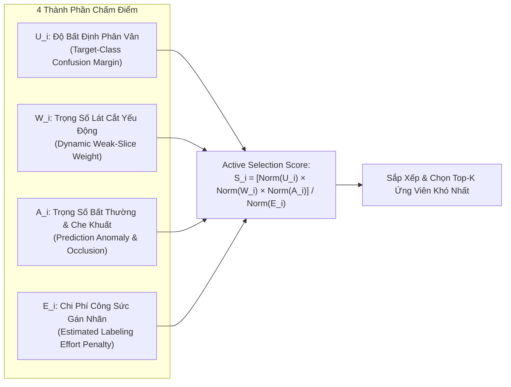
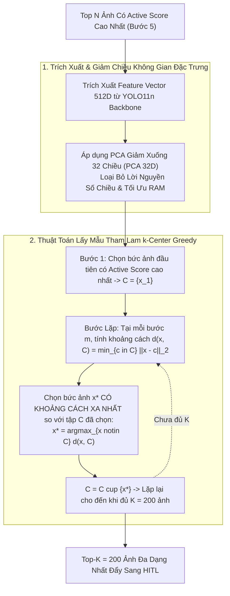

# Thuật Toán Khai Thác Mẫu & Lọc Đa Dạng Hóa Core-Set (Active Mining & Diversity)

- **Dự án**: GreenSM Human-in-the-Loop Active Learning Platform
- **Mã quy trình**: `PIPELINE-STEP-04-05-06`
- **Phiên bản**: V3.0 Final
- **Cập nhật lần cuối**: 09/10/2026

---

## 1. Bước 4 — Khởi Tạo Tập Mầm (Seed Set) & Huấn Luyện Baseline Model V0

### 1.1. Chiến Lược Lấy Mẫu Phân Tầng Cân Bằng (Balanced Stratified Sampling)
Để mô hình khởi đầu (**Model V0**) có nền tảng vững chắc nhất mà không tốn nhiều ngân sách gán nhãn:
- Trích xuất **~200 – 250 ảnh** (tương đương khoảng 10% kho dữ liệu Unlabeled Pool).
- Tuân thủ nghiêm ngặt tính độc lập nhóm (Group-Aware), không lấy mẫu từ các video thuộc Test/Val.
- Kế thừa cơ cấu tỷ lệ **Stress-Test** (25% Daylight, 25% Night, 25% Small Object, 25% High Occlusion) giúp Model V0 tiếp cận ngay các tình huống gai góc nhất của giao thông Việt Nam.

### 1.2. Huấn Luyện Nhanh Model V0 Làm Máy Tạo Nhãn Mồi (Pseudo-Labeler)
- Sử dụng trọng số khởi tạo COCO gốc của **YOLO11n**.
- Tái cấu trúc Detection Head từ 80 classes sang **5 classes** (`greensm, car, motorcycle, bus, truck`).
- Huấn luyện 50 epochs trên tập Seed Set với **Fixed Val Set** làm mốc dừng sớm (Early Stopping).
- Chạy đánh giá Model V0 trên **Fixed Test Set** để trích xuất chỉ số độ nhạy cơ sở: $Recall_{night}^{(V0)}$, $Recall_{small}^{(V0)}$, $Recall_{occ}^{(V0)}$.

---

## 2. Bước 5 — Thuật Toán Chấm Điểm Ưu Tiên (Cost-Aware Active Scoring)

Hệ thống cho Model V0 suy luận trên toàn bộ Unlabeled Pool. Dựa trên phân phối xác suất dự đoán và metadata của ảnh, thuật toán tính điểm ưu tiên tuyển chọn (**Selection Score**):

### 2.1. Chi Tiết 4 Biến Số Cấu Thành
1. **Target-Class Confusion Margin ($U_i$) — Đo Lường Độ Bối Rối Giữa GreenSM và Car**:
   - Nếu xác suất của hộp bao giữa $P(\text{greensm})$ và $P(\text{car})$ quá sát nhau (ví dụ: mô hình đoán 51% là taxi, 49% là ô tô con), đây là khu vực ranh giới quyết định (Decision Boundary) mà mô hình cần con người giải cứu:
     $$U_{box} = 1 - |P(\text{greensm}) - P(\text{car})|$$
   - Điểm bất định cấp ảnh ($U_i$) được lấy theo giá trị lớn nhất trong các hộp bao dự đoán:
     $$U_i = \max_{box} (U_{box})$$

2. **Dynamic Weak-Slice Weight ($W_i$) — Bù Đắp Điểm Mù Của Model V0**:
   - Tự động lấy nghịch đảo độ nhạy của lát cắt tương ứng từ kết quả kiểm tra của Model V0 trên Fixed Test Set:
     $$W_i = \frac{1}{\max(Recall_{slice\_i}(\text{Model } V_0), 0.1)}$$
   - *Ý nghĩa*: Nếu V0 thi kém ở ban đêm ($Recall_{night} = 40\%$), trọng số $W_{night} = \frac{1}{0.4} = 2.5$, giúp toàn bộ ảnh chụp ban đêm được tự động nhân hệ số ưu tiên cao vọt lên.

3. **Prediction Anomaly ($A_i$) — Nhận Diện Nguy Cơ Che Khuất & Hỗn Loạn**:
   - Ảnh chứa hộp bao xe mục tiêu bị che khuất một phần ($IoA > 30\%$) hoặc nằm trong khung cảnh có mật độ xe máy vây quanh lớn ($N_{motorcycle} > 15$).

4. **Estimated Labeling Effort Penalty ($E_i$) — Phạt Ảnh Quá Tốn Công Vô Ích**:
   - Một bức ảnh có tới 40 chiếc xe rác ngoại cảnh nhưng không có xe taxi GreenSM nào sẽ làm tiêu tốn thời gian căn chỉnh vô ích của annotator:
     $$E_i = 1 + 0.05 \times N_{context\_boxes}$$

### 2.2. Công Thức Chuẩn Hóa Điểm Tổng Hợp
Tất cả các thành phần được chuẩn hóa Min-Max về khoảng $[0, 1]$ trước khi nhân hợp nhất:
$$\text{Selection Score}_i = \frac{\text{Norm}(U_i) \times \text{Norm}(W_i) \times \text{Norm}(A_i)}{\text{Norm}(E_i)}$$

---

## 3. Bước 6 — Lọc Đa Dạng Hóa Bối Cảnh (Core-Set / k-Center Greedy)

Nếu chỉ chọn $K$ bức ảnh có điểm $\text{Selection Score}$ cao nhất, hệ thống sẽ gặp hiện tượng **Redundancy Collapse**: Bốc phải hàng trăm bức ảnh cùng chụp tại một góc ngã tư kẹt xe. Để triệt tiêu sự lãng phí này, hệ thống áp dụng kỹ thuật **$k$-Center Greedy (Core-Set)**:

### 3.1. Ưu Điểm Tuyệt Đối Của k-Center Greedy So Với K-Means
1. **Độ Bao Phủ Minimax (Minimax Facility Coverage)**:
   - Thuật toán tối thiểu hóa bán kính bao phủ cực đại: $\min_C \max_{x \in X} \min_{c \in C} \|x - c\|$, bảo đảm $K$ bức ảnh được chọn sẽ "rải thảm" đồng đều trên toàn bộ không gian đặc trưng bối cảnh, không bỏ sót ngóc ngách nào.
2. **Điểm Thực Tế 100% (No Virtual Centroids)**:
   - Trong K-Means, tâm cụm là một vector trung bình số học ảo không ứng với bức ảnh nào. Trong $k$-Center Greedy, mỗi điểm được chọn luôn là một bức ảnh thực tế hiện hữu trong kho dữ liệu.
3. **Hiệu Năng Tính Toán Cực Cao**:
   - Thuật toán duyệt tham lam một chiều trong không gian 32 chiều (PCA 32D), thời gian thực thi cho 2.000 mẫu chỉ mất dưới **1.2 giây** trên CPU.
