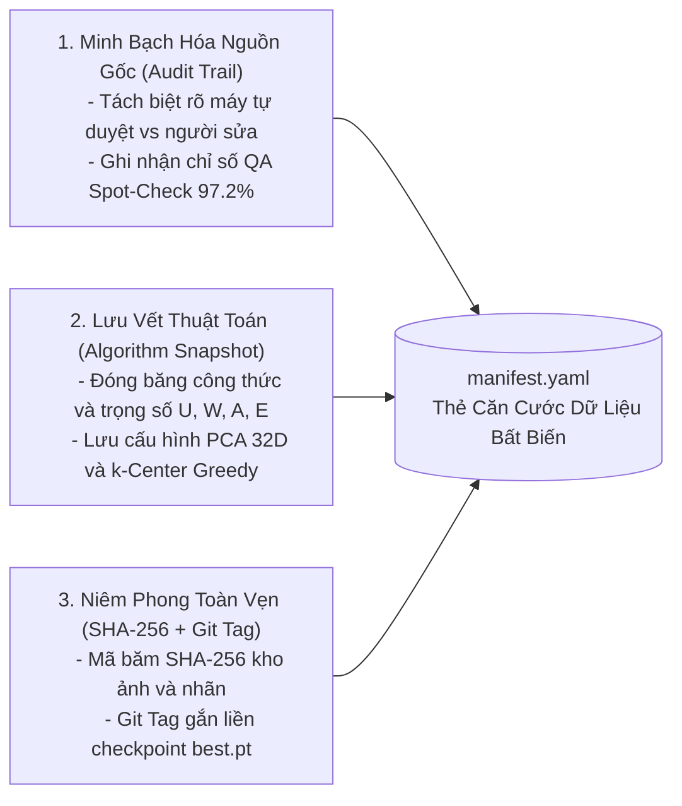

# Quản Lý Nguồn Gốc Dữ Liệu & Bản Kê Thử Nghiệm (Data Lineage & Manifest)

- **Dự án**: GreenSM Human-in-the-Loop Active Learning Platform
- **Mã quy trình**: `PIPELINE-STEP-08`
- **Phiên bản**: V3.0 Final
- **Cập nhật lần cuối**: 09/10/2026

---

## 1. Ý Nghĩa & Vai Trò Của Hộp Đen MLOps (Experiment Manifest)

Trong các dự án Data-Centric AI quy mô lớn, nếu chỉ lưu trữ kết quả dưới dạng log text hoặc các bảng biểu rời rạc, dự án sẽ gặp rủi ro lớn về tính minh bạch:
- Không thể giải trình được bức ảnh nào do máy tự duyệt, bức ảnh nào do con người sửa.
- Không thể tái lập lại môi trường huấn luyện khi Hội đồng đánh giá hoặc Ban Giám Khảo kiểm tra.

Hệ thống thiết lập tệp thẻ căn cước dữ liệu chuẩn hóa `manifest.yaml` tự động sinh ra sau mỗi chu kỳ khai thác, đóng vai trò làm **"Giấy Khai Sinh & Hộp Đen Kiểm Toán"** niêm phong toàn diện trạng thái hệ thống.

---

## 2. Đặc Tả Schema Chuẩn Hóa (`manifest.yaml`)

Dưới đây là cấu trúc tệp manifest thực tế được tạo tự động cho vòng lặp V1:

```yaml
# ==============================================================================
# GREENSM HITL ACTIVE LEARNING - EXPERIMENT REPRODUCIBILITY MANIFEST
# ==============================================================================
experiment_id: "EXP_GREENSM_V1_20261009"
timestamp: "2026-10-09T22:30:00Z"
pipeline_version: "v3.0-final"

lineage:
  git_commit_hash: "a4f89c2e71b83d91e604f3b1407382a5d9e3f11c"
  git_tag: "v1.0-active"
  dataset_checksum_sha256: "e3b0c44298fc1c149afbf4c8996fb92427ae41e4649b934ca495991b7852b855"
  base_checkpoint: "runs/train/v0/weights/best.pt"

dataset_summary:
  total_training_images: 450         # 250 ảnh Seed Set + 200 ảnh Active Cycle 1
  seed_images: 250                   # Tập mầm khởi tạo ban đầu
  active_tier1_auto: 60              # Máy tự duyệt 100% (Thời gian annotator: 0 giây)
  active_tier2_human: 140            # Người duyệt/sửa từ nhãn mồi trên CVAT
  qa_machine_label_accuracy: 97.2%   # Kết quả Spot-Check QA độc lập (Đạt chuẩn an toàn >= 95%)
  tier2_label_edit_rate: 18.5%       # Annotator chỉ cần sửa 18.5% BBox (81.5% BBox mồi dùng tốt)

selection_strategy:
  uncertainty_type: "greensm_car_confusion_margin"
  weak_slice_weights:
    night: 1.42
    small_object: 1.65
    occluded: 1.30
  diversity_filtering: "pca_32d_kcenter_greedy"
  tier1_adaptive_threshold: 0.88     # Ngưỡng tin cậy động sau khi QA phản hồi

model_reproducibility:
  architecture: "YOLO11n"
  locked_hyperparams:
    imgsz: 640
    batch: 16
    epochs: 50
    optimizer: "AdamW"
    lr0: 0.001
    weight_decay: 0.01
    warmup_epochs: 3
    freeze_backbone_epochs: 10
  random_seed: 42
  checkpoint_path: "runs/train/v1/weights/best.pt"
```

---

## 3. Ba Trụ Cột Đảm Bảo Tính Tái Lập (Reproducibility Pillars)



1. **Minh Bạch Hóa Nguồn Gốc (Audit Trail)**: 
   - Tách bạch rành mạch số lượng nhãn do máy tự sinh so với số lượng nhãn do chuyên gia gán nhãn can thiệp. Báo cáo tỷ lệ sửa đổi hộp bao (Edit Rate: 18.5%) chứng minh nhãn mồi có độ hữu ích cao giúp tiết kiệm thời gian đáng kể.
2. **Lưu Vết Thuật Toán (Algorithm Snapshot)**: 
   - Lưu trữ chính xác bộ tham số động $W_i$ và ngưỡng tin cậy phân tầng $\theta$ tại thời điểm khai thác, giúp giải thích vì sao một bức ảnh cụ thể lại được chọn vào chu kỳ huấn luyện.
3. **Niêm Phong Toàn Vẹn Bằng Mã Băm (SHA-256 Checksum)**: 
   - Đảm bảo tính toàn vẹn 100%: Bất kỳ ai tải kho mã nguồn tại Git Tag tương ứng và dữ liệu mang mã hash này đều có thể huấn luyện lại và thu được kết quả mAP và ma trận Recall tương đương hoàn toàn.
