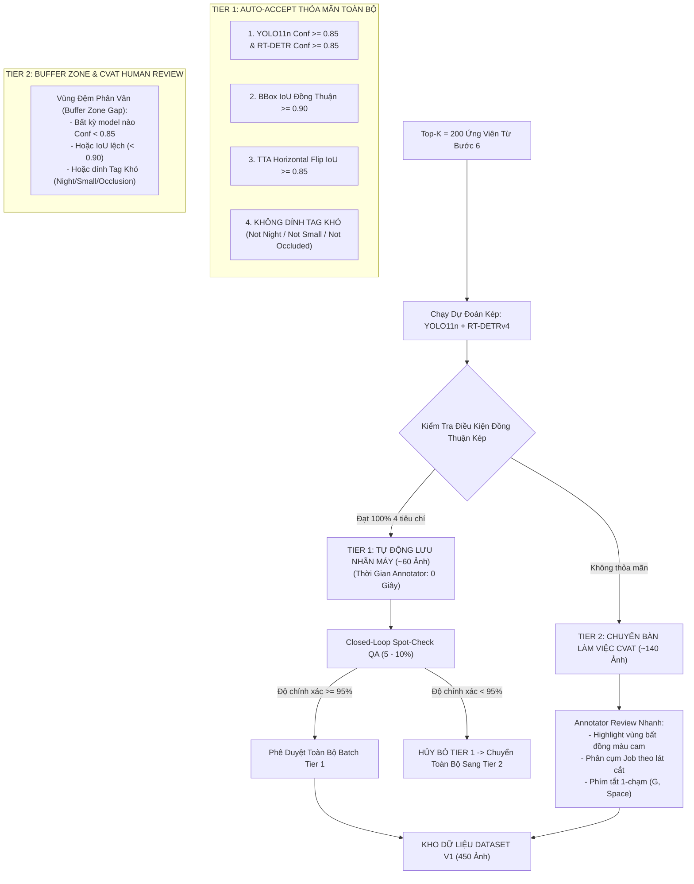

# Cơ Chế Duyệt 2 Tầng HITL & Mô Hình Thẩm Định Kép (Two-Tier HITL & RT-DETR Oracle)

- **Dự án**: GreenSM Human-in-the-Loop Active Learning Platform
- **Mã quy trình**: `PIPELINE-STEP-07`
- **Phiên bản**: V3.0 Final
- **Cập nhật lần cuối**: 09/10/2026

---

## 1. Vấn Đề Thiên Kiến Tự Củng Cố (Confirmation Bias Problem)

Trong các hệ thống Semi-Supervised Learning hoặc Pseudo-Labeling truyền thống chỉ sử dụng một mô hình duy nhất:
- Nếu mô hình tự gán nhãn cho chính mình và nhận nhầm một chiếc ô tô cá nhân màu xanh lá cây thành xe `greensm` với độ tin cậy giả tạo $Conf = 0.88$, mẫu sai lệch này sẽ được lưu vào tập huấn luyện tiếp theo.
- Ở vòng lặp sau, mô hình tiếp tục học lỗi sai này và củng cố niềm tin sai trái (Confirmation Bias), dẫn đến hiện tượng **ngộ độc dữ liệu (Data Poisoning)** và sụt giảm nghiêm trọng độ chính xác (Precision) thực tế.

---

## 2. Giải Pháp: Cross-Model Consensus Oracle (YOLO11n + RT-DETRv4)

Để triệt tiêu hoàn toàn Confirmation Bias, hệ thống triệu tập thêm một mô hình thẩm định độc lập mang kiến trúc hoàn toàn khác biệt: **RT-DETRv4** (Vision Transformer với cơ chế Global Attention đa đầu), đóng vai trò làm **Thẩm Định Viên Độc Lập (Consensus Oracle)**.

---

## 3. Tiêu Chuẩn Phê Duyệt Tự Động Khắt Khe (Tier 1 Criteria)

Một bức ảnh CHỈ được tự động duyệt vào tập huấn luyện mới khi toàn bộ các hộp bao phương tiện trong ảnh thỏa mãn **4 điều kiện đồng thuận thép**:
1. **Độ tin cậy kép siêu cao**: Cả YOLO11n và RT-DETR đều dự đoán đúng class `greensm` với xác suất $Conf \ge 0.85$.
2. **Đồng thuận hình học khắt khe ($IoU \ge 0.90$)**: Hai hộp bao do 2 mạng nơ-ron khác nhau vẽ ra phải trùng khớp lên nhau với tỷ lệ tương đồng hình học cực cao ($IoU \ge 0.90$).
3. **Tính nhất quán tăng cường kiểm thử (TTA Consistency)**: Khi lật ảnh ngang (Horizontal Flip), cả hai mô hình vẫn giữ vững dự đoán với $IoU \ge 0.85$ và sai lệch độ tin cậy $\le 0.05$.
4. **Loại trừ rủi ro lát cắt yếu (Risk Exclusion)**: Tuyệt đối không tự động duyệt bất kỳ ảnh nào bị dính tag **Ban đêm (`Night`)**, **Xe nhỏ ở xa (`Small_Object`)**, hoặc **Che khuất nặng (`High_Occlusion`)**. Mọi ảnh thuộc các lát cắt này bắt buộc phải qua tay con người ở Tier 2.

---

## 4. Kiểm Định Chất Lượng Vòng Lặp Kín (Closed-Loop Spot-Check QA)

Hệ thống thiết lập cơ chế tự điều chỉnh ngưỡng phòng vệ thông qua kết quả kiểm tra của QA Lead:
- **Lấy mẫu kiểm định**: Rút ngẫu nhiên độc lập từ 5% đến 10% số lượng ảnh thuộc Tier 1 để QA Lead thẩm định chéo.
- **Cơ chế phản hồi thích ứng (Adaptive Feedback Loop)**:
  - Nếu **$\text{QA Accuracy} \ge 95\%$**: Toàn bộ batch Tier 1 được công nhận an toàn; hệ thống tự động nới nhẹ ngưỡng tin cậy ($\theta = 0.83$) cho chu kỳ tiếp theo để tối ưu thêm thời gian.
  - Nếu **$\text{QA Accuracy} < 95\%$**: Ngay lập tức thu hồi toàn bộ batch Tier 1 vừa duyệt, chuyển toàn bộ vào hàng đợi Tier 2 để con người rà soát thủ công, đồng thời nâng ngưỡng phòng vệ lên $\theta = 0.90$.

---

## 5. Bàn Làm Việc Tinh Chỉnh Nhanh (Tier 2 Human Refinement)

Đối với ~140 ảnh còn lại (các ca bất đồng ý kiến hoặc thuộc các lát cắt khó):
1. **Tận Dụng Nhãn Mồi Bất Đồng (Pre-label Disagreement Assist)**: 
   - Những vị trí mà YOLO11n và RT-DETR bất đồng (lệch class hoặc lệch box) được highlight viền màu cam cảnh báo nổi bật. Annotator chỉ cần liếc mắt 2 giây vào các hộp màu cam để ra phán quyết cuối cùng, không cần rà soát lại toàn cảnh.
2. **Phân Cụm Giảm Tải Nhận Thức (Cognitive-Load Batching)**:
   - Các ảnh được gom cụm theo từng lát cắt riêng biệt (ví dụ: Job 30 ảnh chuyên Ban đêm, Job 30 ảnh chuyên Xe nhỏ). Annotator làm việc liên tục trong cùng một bối cảnh ánh sáng mà không bị mỏi mắt hoặc xao nhãng do thay đổi bối cảnh liên tục.
3. **Phím Tắt 1 Chạm & Chatbot Hỗ Trợ**:
   - Phím `G` để đổi sang `greensm`, phím `Space` để xác nhận trong 1 giây. Tích hợp RAG Copilot hỗ trợ tra cứu quy chuẩn tức thì.
- **Hiệu quả thực tế**: Giảm thời gian gán nhãn từ 90 giây xuống chỉ còn **15 giây/ảnh**, tiết kiệm hơn 68% công sức mà vẫn bảo đảm 100% độ chính xác cho các ca khó nhất.
