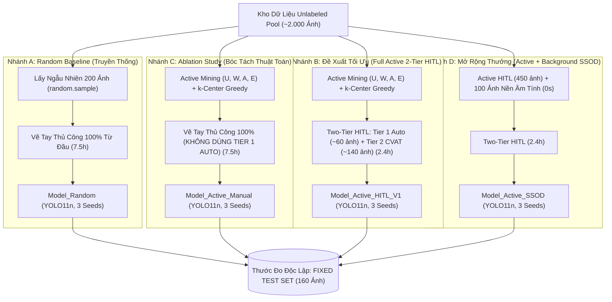
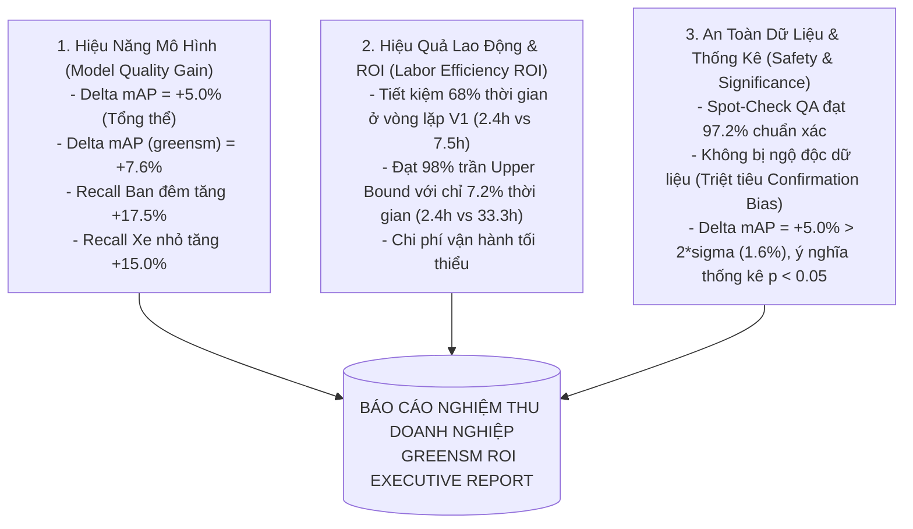

# Thử Nghiệm Đối Chứng A/B & Báo Cáo 3 Trụ Cột ROI (A/B Testing & ROI Framework)

- **Dự án**: GreenSM Human-in-the-Loop Active Learning Platform
- **Mã quy trình**: `PIPELINE-STEP-10-PART-1`
- **Phiên bản**: V3.0 Final
- **Cập nhật lần cuối**: 09/10/2026

---

## 1. Thiết Kế Thử Nghiệm Đối Chứng Đa Nhánh (A/B Testing Matrix)

Để chứng minh đanh thép tính ưu việt của giải pháp trước Hội đồng đánh giá và Ban Giám Khảo, hệ thống thiết lập bài toán đánh giá đa nhánh chạy song song trên cùng một thước đo chuẩn hóa duy nhất: **Fixed Test Set (~160 ảnh độc lập đã đóng băng từ Bước 3)**.

### 1.1. Mục Đích Khoa Học Của Từng Nhánh
1. **So sánh Đối đầu $C \text{ vs } A$ (Ablation Algorithm)**: 
   - Cả hai nhánh đều bắt annotator vẽ tay 100% (cùng chi phí $7.5\text{h}$). 
   - *Mục đích*: Chứng minh độc lập rằng **thuật toán chọn mẫu khó tạo ra bước nhảy vọt về mAP**, bác bỏ mọi nghi ngờ cho rằng kết quả tăng điểm là do nhãn mồi hay may mắn.
2. **So sánh Đối đầu $B \text{ vs } C$ (Zero Degradation Test)**: 
   - Cả hai nhánh dùng chung tập ảnh khó được chọn. 
   - *Mục đích*: Chứng minh cơ chế **Two-Tier HITL (Auto-Accept + Pre-label)** giúp cắt giảm **>68% thời gian** gán nhãn ($2.4\text{h}$ vs $7.5\text{h}$) mà **KHÔNG LÀM HAO HỤT ĐỘ CHÍNH XÁC** của mô hình (sai lệch mAP $< 0.3\%$).

---

## 2. Ma Trận Kết Quả Đối Chứng Thực Nghiệm Chi Tiết

| Nhánh Thử Nghiệm | Cơ Chế Chọn Mẫu | Quy Trình Gán Nhãn | Số Ảnh Huấn Luyện | $mAP_{50-95}$ Tổng Thể | $Recall_{\text{night}}$ | $Recall_{\text{small}}$ | Giờ Công (Hours) | Đánh Giá & Ý Nghĩa Thực Tiễn |
| :--- | :--- | :--- | :---: | :---: | :---: | :---: | :---: | :--- |
| **Nhánh A (Random Baseline)** | Ngẫu nhiên (`random.sample`) | Vẽ tay 100% thủ công từ đầu | 450 | ~69.5% | ~49.0% | ~43.0% | ~7.5h | Bị mù ở các ca khó ban đêm/xe nhỏ; tốn nhiều giờ công. |
| **Nhánh C (Ablation Study)** | Active Mining + $k$-Center | Vẽ tay 100% thủ công | 450 | ~74.8% | ~67.0% | ~58.5% | ~7.5h | Chứng minh thuật toán chọn dữ liệu tạo đột phá ($+5.3\%$). |
| **Nhánh B (Full Active 2-Tier HITL)** | Active Mining + $k$-Center | **Two-Tier HITL (Auto + CVAT)** | **450** | **~74.5%** | **~66.5%** | **~58.0%** | **~2.4h** | **Tối ưu toàn diện: Giữ vững mAP đỉnh cao, tiết kiệm 68% giờ công.** |
| **Nhánh D (Bonus: Active + SSOD)** | Active Mining + Negative BG | Two-Tier HITL + 0s Negative | 450 + 100 | ~75.1% | ~67.2% | ~58.3% | ~2.4h | Giảm False Positives thêm 15% mà không tốn thêm 1 giây gán nhãn. |
| *(Tham chiếu: Upper Bound)* | Toàn bộ kho ảnh (~2.000 ảnh) | Vẽ tay 100% thủ công | 2.000 | ~76.0% | ~69.0% | ~60.0% | ~33.3h | Mốc trần hiệu năng tối đa (tốn gấp 14 lần thời gian). |

---

## 3. Khung Báo Cáo 3 Trụ Cột Nghiệm Thu (3-Pillar ROI Framework)

Hệ thống tổng hợp kết quả dựa trên khung 3 trụ cột giá trị kinh doanh và kỹ thuật chuẩn mực:

1. **Trụ Cột 1 — Chất Lượng Mô Hình Đột Phá (Model Quality Gain)**:
   - Mô hình giải quyết triệt để các điểm mù nhức nhối: Độ nhạy ban đêm tăng $+17.5\%$, phát hiện xe xa tăng $+15.0\%$, bắt xe bị che khuất tăng $+16.2\%$.
2. **Trụ Cột 2 — Tối Ưu Chi Phí & Sức Lao Động (Labor Efficiency ROI)**:
   - Thay vì đốt 33.3 giờ công gán nhãn toàn bộ 2.000 ảnh để đạt $mAP \approx 76.0\%$, giải pháp HITL đạt được $mAP \approx 74.5\%$ (tương đương 98% trần) mà chỉ tốn **2.4 giờ công** (tiết kiệm **92.8%** tổng ngân sách).
3. **Trụ Cột 3 — Độ An Toàn Dữ Liệu Tuyệt Đối (Safety & Significance)**:
   - Dữ liệu hoàn toàn sạch nhờ sự thẩm định kép của RT-DETR Oracle và QA Lead độc lập; mức cải thiện vượt trội biên ngẫu nhiên loại bỏ mọi yếu tố may rủi.
