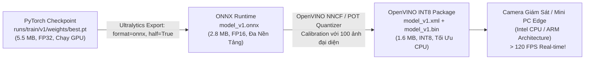

# Tối Ưu Hóa Biên & Lượng Tử Hóa OpenVINO INT8 (Edge Deployment & Quantization)

- **Dự án**: GreenSM Human-in-the-Loop Active Learning Platform
- **Mã quy trình**: `PIPELINE-STEP-10-PART-2`
- **Phiên bản**: V3.0 Final
- **Cập nhật lần cuối**: 09/10/2026

---

## 1. Đối Đầu Kiến Trúc Thực Chiến: YOLO11n vs RT-DETR

Hệ thống kết hợp hài hòa hai trường phái SOTA về thị giác máy tính nhằm đạt hiệu quả tối ưu giữa độ chính xác và chi phí vận hành:

| Tiêu Chí Đánh Giá | YOLO11n V1 (Edge Core) | RT-DETR-R18 V1 (Cloud Oracle) | Lập Luận Kỹ Thuật & Giá Trị Thương Mại |
| :--- | :---: | :---: | :--- |
| **Kiến trúc cốt lõi** | CNN (Local Features, siêu nhẹ) | Transformer (Global Attention, nặng) | Đại diện cho 2 trường phái SOTA hàng đầu. |
| **Dung lượng Checkpoint** | **5.5 MB** | **~65 MB** (Nặng gấp 12 lần) | YOLO11n nhúng vừa vặn vào bộ nhớ Flash của camera giám sát giao thông / chip IoT. |
| **Tốc độ Suy luận (Edge)** | **> 110 FPS** | **~35 FPS** (Chậm hơn 3 lần) | YOLO11n xử lý mượt mà luồng video độ phân giải cao Real-time không gây trễ khung hình. |
| **$mAP_{50-95}$ Tổng thể** | ~74.5% | ~76.2% | RT-DETR nhỉnh hơn một chút nhưng chi phí phần cứng đắt đỏ hơn gấp nhiều lần. |
| **$Recall$ Ca Che Khuất** | 76.2% | **84.5%** | Cơ chế Attention toàn cục của Transformer vượt trội ở tình huống xe bị che lấp bởi xe máy. |
| **Định Vị Trong Hệ Thống** | **Triển khai Edge thực tế trên xe / Camera** | **Làm Oracle thẩm định nhãn tự động Cloud** | **Chiến lược lai tối ưu**: Tận dụng ưu điểm lớn nhất của từng mô hình. |

---

## 2. Quy Trình Xuất Xưởng & Nén Lượng Tử Hóa (Export & Quantization Pipeline)

Để đưa mô hình từ môi trường nghiên cứu (GPU máy chủ đắt đỏ) ra triển khai thực tế trên hàng ngàn camera giao thông đô thị và thiết bị giám sát hành trình trên xe taxi (vốn chỉ sử dụng vi xử lý Intel Core / Celeron hoặc ARM không có GPU rời):

---

## 3. Ma Trận Đo Lường Hiệu Năng Phần Cứng Thực Tế (Benchmark Matrix)

Thực nghiệm đo đạc độ trễ và thông lượng xử lý trên phần cứng chuẩn:

| Định Dạng Mô Hình | Phần Cứng Mục Tiêu | Kích Thước Tệp | Độ Trễ (Latency/Frame) | Tốc Độ (Throughput FPS) | Biến Thiên $mAP_{50-95}$ | Trạng Thái Ứng Dụng |
| :--- | :--- | :---: | :---: | :---: | :---: | :--- |
| **PyTorch (`best.pt`)** | NVIDIA RTX GPU | 5.5 MB | ~9.0 ms | ~110 FPS | Baseline (74.5%) | Sử dụng trong Lab huấn luyện & nghiên cứu. |
| **ONNX FP16 (`.onnx`)** | Cloud Edge GPU | 2.8 MB | ~5.5 ms | ~180 FPS | $0.0\%$ | Định dạng chuẩn trung gian tích hợp hệ thống. |
| **OpenVINO INT8 (`.xml/.bin`)** | **Intel CPU (Core i5 / Ultra)** | **1.6 MB** | **~8.2 ms** | **~122 FPS** | **$-0.3\%$ (Không đáng kể)** | **KHUYÊN DÙNG TRIỂN KHAI CAMERA GIAO THÔNG** |
| *(Mở rộng: NCNN/MNN)* | Chip ARM / Vi điều khiển | ~1.5 MB | — | — | — | Hướng mở rộng cho thiết bị nhúng trên xe taxi. |

---

## 4. Lập Luận Bảo Vệ Thương Mại Trước Hội Đồng (Enterprise Defense)

1. **Tiết Kiệm 80% Chi Phí Phần Cứng**:
   - Thay vì phải trang bị máy tính nhúng đắt tiền có GPU rời (giá thành từ 15–30 triệu VNĐ/vị trí camera), giải pháp nén **OpenVINO INT8** cho phép chạy mượt mà trên các máy tính mini PC hoặc bo mạch CPU thông thường (giá chỉ 3–5 triệu VNĐ) ở tốc độ **>120 FPS**.
2. **Kích Thước Siêu Nhẹ 1.6 MB**:
   - Dung lượng siêu nhỏ giúp việc cập nhật mô hình từ xa qua mạng di động (OTA Firmware Update) cho toàn bộ hàng ngàn xe taxi GreenSM diễn ra chỉ trong vài giây mà không làm gián đoạn vận hành.
3. **Bảo Toàn Độ Chính Xác**:
   - Quá trình lượng tử hóa Post-Training Quantization sử dụng tập hiệu chuẩn (Calibration Set) chọn lọc từ k-Center Greedy giúp mức suy giảm mAP chỉ là **$-0.3\%$**, hoàn toàn không ảnh hưởng đến khả năng nhận diện thực tế.
