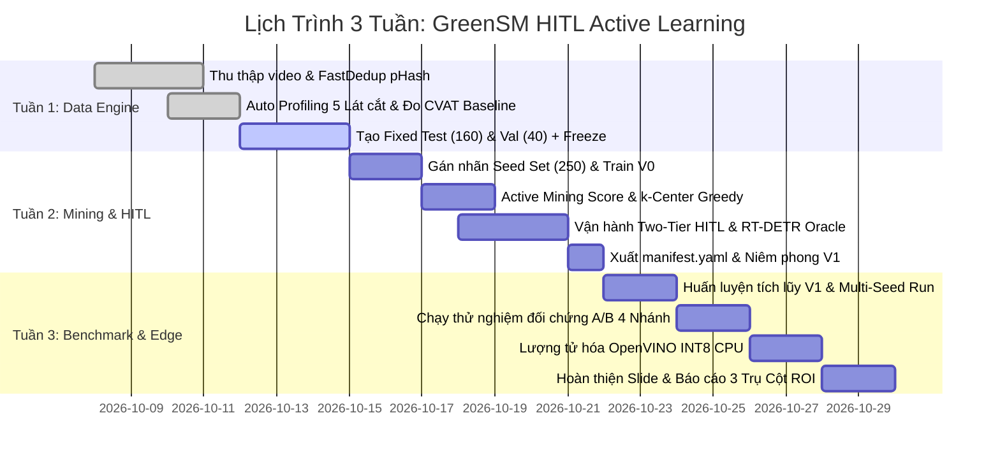

# Sổ Tay Vận Hành HITL & Kế Hoạch 3 Tuần (Operations Runbook & Timeline)

- **Dự án**: GreenSM Human-in-the-Loop Active Learning Platform
- **Mã tài liệu**: `OPS-RUNBOOK-TIMELINE`
- **Thời gian dự án**: 3 Tuần (08/10/2026 – 29/10/2026)
- **Cập nhật lần cuối**: 09/10/2026

---

## 1. Ước Tính Khối Lượng & Ngân Sách Gán Nhãn Thực Tế (Workload Estimation)

Để chứng minh đề tài hoàn toàn khả thi và vừa sức thực hiện trong thời gian **3 tuần**, ngân sách công sức lao động được lập định mức khoa học và đồng bộ tuyệt đối với các khâu kỹ thuật:

| Thành Phần Dữ Liệu | Quy Mô Mẫu | Phương Thức Triển Khai | Định Mức Thời Gian | Tổng Giờ Công Thực Tế |
| :--- | :---: | :--- | :---: | :---: |
| **1. Fixed Test Set** | 160 ảnh | Pre-labeling + Chuyên gia căn chỉnh BBox tỉ mỉ | 30 giây/ảnh | **1.33 giờ** (80 phút) |
| **2. Fixed Val Set** | 40 ảnh | Pre-labeling + Human Review | 25 giây/ảnh | **0.28 giờ** (17 phút) |
| **3. Seed Set (Model V0)** | 250 ảnh | Pre-labeling + Human Refinement (5 classes) | 25 giây/ảnh | **1.74 giờ** (104 phút) |
| **4. Active V1 (Tier 1)** | 60 ảnh | **Auto-Accept kép (YOLO11n + RT-DETR Oracle)** | **0 giây** | **0.00 giờ** (Máy tự duyệt 100%) |
| **5. Active V1 (Tier 2)** | 140 ảnh | CVAT Human Review (Phím tắt 1-chạm + Nhãn mồi) | 15 giây/ảnh | **0.58 giờ** (35 phút) |
| **6. Spot-Check QA Tier 1** | 10 ảnh | QA Lead độc lập kiểm tra chéo độ chính xác | 20 giây/ảnh | **0.06 giờ** (3.5 phút) |
| **7. Nhánh A (Random Baseline)** | 200 ảnh | Vẽ tay thủ công 100% (đối chứng A/B Test) | 45 giây/ảnh | **2.50 giờ** (150 phút) |
| **8. Background Mining** | 100 ảnh | Lọc tự động từ 1.500 ảnh Unlabeled (SSOD Bonus) | 0 giây | **0.00 giờ** (Máy tự lọc 100%) |
| **TỔNG CỘNG TOÀN DỰ ÁN** | **950 ảnh** | *(Người thực làm: 790 ảnh + 10 QA)* | — | **~6.5 giờ công** |

> [!NOTE]
> **Đánh giá tính khả thi:** Tổng ngân sách gán nhãn cho toàn bộ dự án chỉ tốn khoảng **~6.5 giờ công**. Một nhóm 2–3 thành viên chỉ cần dành **khoảng 2 – 2.5 giờ/người** rải đều trong 3 tuần là hoàn thành 100% dữ liệu đạt chuẩn vàng, hoàn toàn triệt tiêu rủi ro vỡ tiến độ.

---

## 2. Lịch Trình Thực Thi 3 Tuần Chi Tiết (Execution Roadmap)

### 2.1. Tuần 1 (08/10 – 14/10): Data Profiling & Đóng Băng Kép (Dual-Freeze)
- Chạy trích xuất khung hình 1 FPS và thuật toán [Dual-Stream FastDedup](file:///Users/huynh/projects/h20k_vinuni/lv2-3/projects/project-hackathon-greenSM/docs/02-data-engine/deduplication-and-profiling.md) cắt giảm 90% frame trùng.
- Chạy thuật toán tự động gắn metadata 5 lát cắt (Ban đêm, Mờ, Xe nhỏ xa, Che khuất, Mật độ cao).
- Thực hiện A/B Time Trial đo mốc $T_{manual}$ ($75\text{s}$) so với $T_{assisted}$ ($20\text{s}$) trên CVAT.
- Gán nhãn và kích hoạt cơ chế [Dual-Freeze](file:///Users/huynh/projects/h20k_vinuni/lv2-3/projects/project-hackathon-greenSM/docs/02-data-engine/dataset-splits-and-freeze.md): Đóng băng Fixed Test Set (160 ảnh) và Fixed Val Set (40 ảnh), sinh mã hash SHA-256 và gắn Git Tag `v1.0-fixed-eval-freeze`.

### 2.2. Tuần 2 (15/10 – 21/10): Seed Training, Active Mining & Vòng Lặp Two-Tier HITL
- Hoàn thiện 250 ảnh Seed Set bằng nhãn mồi $\rightarrow$ Huấn luyện **Model V0 (YOLO11n)** và fine-tune nhanh **RT-DETRv4 V0**.
- Chạy Model V0 trên Unlabeled Pool, tính điểm [Cost-Aware Active Score](file:///Users/huynh/projects/h20k_vinuni/lv2-3/projects/project-hackathon-greenSM/docs/03-active-learning-hitl/active-mining-core.md) ($S_i = \frac{U_i \cdot W_i \cdot A_i}{E_i}$).
- Lọc đa dạng hóa bối cảnh bằng **PCA 32D + $k$-Center Greedy** chọn 200 ảnh khó nhất.
- Đẩy dữ liệu qua [Two-Tier HITL](file:///Users/huynh/projects/h20k_vinuni/lv2-3/projects/project-hackathon-greenSM/docs/03-active-learning-hitl/two-tier-hitl-oracle.md): Tier 1 máy tự duyệt ~60 ảnh (có RT-DETR Oracle bảo vệ), Tier 2 annotator duyệt ~140 ảnh trên giao diện; QA Lead spot-check đạt $\ge 95\%$.
- Tự động sinh `manifest.yaml` và niêm phong Git Tag `v1.0-active`.

### 2.3. Tuần 3 (22/10 – 29/10): Retrain Model V1, Multi-Seed Validation, A/B Test & ROI
- Huấn luyện tích lũy [Model V1](file:///Users/huynh/projects/h20k_vinuni/lv2-3/projects/project-hackathon-greenSM/docs/04-model-and-benchmarks/training-protocol-yolo11n.md) (450 ảnh: 250 seed + 200 active) trên Fixed Val Set; nạp kèm 100 ảnh bối cảnh âm tính (Negative Backgrounds).
- Chạy kiểm định 3 Random Seeds chứng minh $\Delta mAP > 2\sigma_{seed}$ ($p < 0.05$).
- Thực hiện thử nghiệm đối chứng [A/B Test 4 nhánh](file:///Users/huynh/projects/h20k_vinuni/lv2-3/projects/project-hackathon-greenSM/docs/04-model-and-benchmarks/ab-testing-and-ablation.md) trên Fixed Test Set.
- Xuất mô hình sang [OpenVINO INT8 CPU](file:///Users/huynh/projects/h20k_vinuni/lv2-3/projects/project-hackathon-greenSM/docs/04-model-and-benchmarks/edge-deployment-openvino.md), kiểm chứng tốc độ >120 FPS trên vi xử lý thông thường.
- Hoàn thiện slide báo cáo tổng kết theo Khung 3 Trụ Cột ROI (Chất lượng mô hình, Tiết kiệm giờ công, An toàn dữ liệu).

---

## 3. Phân Công Trách Nhiệm & Độc Lập QA (Roles & Permissions)

1. **Kỹ sư Mô hình & Active Learning Pipeline Lead**:
   - Chịu trách nhiệm viết script Profiling, trích xuất embedding, tính Active Score, thuật toán $k$-Center Greedy và huấn luyện YOLO11n.
   - Điều phối luồng chuyển giao dữ liệu giữa Backend và giao diện HITL Studio.
2. **Kỹ sư Kiểm định Test Set & QA Lead (Tách Biệt Độc Lập)**:
   - **Hoàn toàn độc lập với người huấn luyện mô hình** để tránh xung đột lợi ích.
   - Chịu trách nhiệm kiểm tra chất lượng và niêm phong tập kiểm thử Fixed Test Set.
   - Chịu trách nhiệm rút mẫu Spot-check 5–10% các mẫu Tier 1 Auto-Accept để đo chỉ số Machine Label Accuracy.
3. **Kỹ sư Quản lý Tái Lập & Manifest Lead**:
   - Quản lý các tệp `manifest.yaml`, lưu trữ cấu hình siêu tham số, seed, git tags và model checkpoints.
   - Đảm bảo 100% thí nghiệm có thể tái lập tức thì khi Mentor hoặc Hội đồng kiểm tra.
