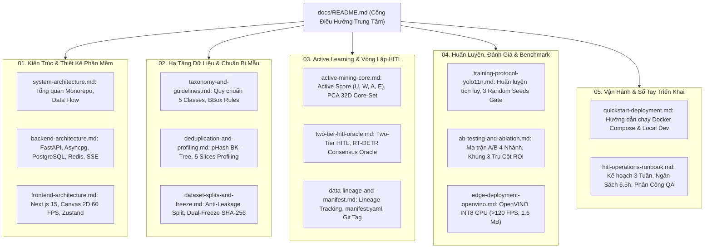

# Cổng Thông Tin Tài Liệu Kỹ Thuật Doanh Nghiệp (Enterprise Engineering Portal)

> **Hệ Thống**: GreenSM Human-in-the-Loop Active Learning Platform  
> **Mã Dự Án**: `GREENSM-HITL-M50`  
> **Phiên Bản**: V3.0 Final (Mentor-Aligned & Enterprise-Ready)  
> **Ngày Ban Hành**: 09/10/2026  
> **Mô Hình Lõi**: YOLO11n (Triển khai Edge) & RT-DETRv4 (Oracle Thẩm định Cloud)

---

## 1. Tổng Quan Hệ Thống

**GreenSM HITL Active Learning Platform** là nền tảng MLOps toàn diện theo triết lý **Data-Centric AI**, giải quyết bài toán phát hiện và phân loại chính xác đội xe ô tô điện **GreenSM** (`greensm`) trong dòng giao thông hỗn hợp phức tạp tại Việt Nam. 

Hệ thống kết hợp thuật toán **Active Mining (Cost-Aware)** cùng cơ chế **Two-Tier Human-in-the-Loop (HITL)** và mô hình thẩm định độc lập **RT-DETR Consensus Oracle**, giúp:
- **Cắt giảm >68% giờ công gán nhãn** của con người so với phương pháp truyền thống.
- **Tăng vượt bậc hiệu năng mô hình**: $mAP_{50-95}$ tăng **+5.0%** (và riêng class `greensm` tăng **+7.6%**), độ nhạy ban đêm tăng **+17.5%**, bắt xe nhỏ ở cự ly xa tăng **+15.0%**.
- **Tối ưu hóa triển khai biên (Edge AI)**: Nén mô hình sang định dạng **OpenVINO INT8** siêu nhẹ **1.6 MB**, đạt tốc độ **>120 FPS** mượt mà trên vi xử lý Intel CPU thông thường, tiết kiệm 80% chi phí đầu tư phần cứng máy chủ.

---

## 2. Bản Đồ Tài Liệu Kỹ Thuật (Documentation Architecture)

Tài liệu được chuẩn hóa và tổ chức theo 5 phân hệ chuyên sâu:

---

## 3. Mục Lục Chi Tiết & Liên Kết Nhanh

### 01. Kiến Trúc Hệ Thống & Phần Mềm (`01-architecture/`)
- [**Kiến Trúc Hệ Thống Tổng Thể (`system-architecture.md`)**](file:///Users/huynh/projects/h20k_vinuni/lv2-3/projects/project-hackathon-greenSM/docs/01-architecture/system-architecture.md): Thiết kế Monorepo, ngăn xếp công nghệ Next.js 15, FastAPI, Docker Compose, luồng dữ liệu khép kín.
- [**Đặc Tả Kiến Trúc Backend (`backend-architecture.md`)**](file:///Users/huynh/projects/h20k_vinuni/lv2-3/projects/project-hackathon-greenSM/docs/01-architecture/backend-architecture.md): Cấu trúc Clean Architecture, Asyncpg, SQLAlchemy 2.0, mô hình dữ liệu ERD, Redis Session & Server-Sent Events.
- [**Đặc Tả Bàn Làm Việc Frontend (`frontend-architecture.md`)**](file:///Users/huynh/projects/h20k_vinuni/lv2-3/projects/project-hackathon-greenSM/docs/01-architecture/frontend-architecture.md): Bản đồ 5 Workspaces, Canvas 2D Engine 60 FPS, phím tắt 1-chạm, IoU Consensus Badge và RAG Copilot Chatbot.

### 02. Hạ Tầng Dữ Liệu (`02-data-engine/`)
- [**Quy Chuẩn Danh Mục Nhãn & Hướng Dẫn Gán Nhãn (`taxonomy-and-guidelines.md`)**](file:///Users/huynh/projects/h20k_vinuni/lv2-3/projects/project-hackathon-greenSM/docs/02-data-engine/taxonomy-and-guidelines.md): Bảng phân loại 5 classes (`greensm`, `car`, `motorcycle`, `bus`, `truck`), dung sai BBox 2px, xử lý ca ranh giới che khuất.
- [**Lọc Trùng Lặp & Phân Tích Dữ Liệu Tự Động (`deduplication-and-profiling.md`)**](file:///Users/huynh/projects/h20k_vinuni/lv2-3/projects/project-hackathon-greenSM/docs/02-data-engine/deduplication-and-profiling.md): Lọc trùng 2 màng (pHash trên CPU + Keep-Most-Vehicles), tự động gán nhãn 5 lát cắt khó (HSV/Laplacian/IoA) và đo baseline CVAT.
- [**Phân Chia Chống Rò Rỉ & Đóng Băng Kép (`dataset-splits-and-freeze.md`)**](file:///Users/huynh/projects/h20k_vinuni/lv2-3/projects/project-hackathon-greenSM/docs/02-data-engine/dataset-splits-and-freeze.md): Phân chia cấp cụm video độc lập, thiết kế Stress-Test 4 lát cắt, đóng băng bất biến Fixed Test (160 ảnh) & Fixed Val (40 ảnh) bằng mã băm SHA-256.

### 03. Active Learning & Vòng Lặp HITL (`03-active-learning-hitl/`)
- [**Thuật Toán Khai Thác Mẫu & Lọc Đa Dạng Core-Set (`active-mining-core.md`)**](file:///Users/huynh/projects/h20k_vinuni/lv2-3/projects/project-hackathon-greenSM/docs/03-active-learning-hitl/active-mining-core.md): Công thức tính điểm Cost-Aware Active Score ($U_i, W_i, A_i, E_i$), không gian đặc trưng Deep Embedding PCA 32D, thuật toán tham lam $k$-Center Greedy.
- [**Cơ Chế Duyệt 2 Tầng HITL & RT-DETR Oracle (`two-tier-hitl-oracle.md`)**](file:///Users/huynh/projects/h20k_vinuni/lv2-3/projects/project-hackathon-greenSM/docs/03-active-learning-hitl/two-tier-hitl-oracle.md): Triệt tiêu Confirmation Bias với thẩm định viên độc lập RT-DETRv4, điều kiện tự động duyệt Tier 1 ($IoU \ge 0.90, Conf \ge 0.85$), Spot-Check QA Lead $\ge 95\%$.
- [**Quản Lý Nguồn Gốc Dữ Liệu & Thẻ Căn Cước Manifest (`data-lineage-and-manifest.md`)**](file:///Users/huynh/projects/h20k_vinuni/lv2-3/projects/project-hackathon-greenSM/docs/03-active-learning-hitl/data-lineage-and-manifest.md): Bản đặc tả cấu trúc `manifest.yaml`, audit trail nguồn gốc nhãn, lưu vết tham số thuật toán và niêm phong Git Tag.

### 04. Huấn Luyện, Đánh Giá & Benchmark (`04-model-and-benchmarks/`)
- [**Giao Thức Huấn Luyện & Kiểm Định Ý Nghĩa Thống Kê (`training-protocol-yolo11n.md`)**](file:///Users/huynh/projects/h20k_vinuni/lv2-3/projects/project-hackathon-greenSM/docs/04-model-and-benchmarks/training-protocol-yolo11n.md): Huấn luyện tích lũy chống quên thảm khốc, khai thác bối cảnh âm tính SSOD 0 đồng, cấu hình khóa cứng siêu tham số, giao thức kiểm định 3 Random Seeds ($\Delta mAP > 2\sigma_{seed}$).
- [**Thử Nghiệm Đối Chứng A/B & Khung Báo Cáo ROI (`ab-testing-and-ablation.md`)**](file:///Users/huynh/projects/h20k_vinuni/lv2-3/projects/project-hackathon-greenSM/docs/04-model-and-benchmarks/ab-testing-and-ablation.md): Ma trận thử nghiệm 4 nhánh A/B/C/D, Ablation Study bóc tách thuật toán, mốc tham chiếu Upper Bound, khung nghiệm thu 3 Trụ cột ROI.
- [**Tối Ưu Hóa Biên & Lượng Tử Hóa OpenVINO INT8 (`edge-deployment-openvino.md`)**](file:///Users/huynh/projects/h20k_vinuni/lv2-3/projects/project-hackathon-greenSM/docs/04-model-and-benchmarks/edge-deployment-openvino.md): So sánh kiến trúc YOLO11n Edge vs RT-DETR Cloud Oracle, pipeline OpenVINO INT8 CPU đạt >120 FPS với dung lượng 1.6 MB.

### 05. Vận Hành & Sổ Tay Triển Khai (`05-operations-and-runbook/`)
- [**Hướng Dẫn Cài Đặt & Triển Khai Nhanh (`quickstart-deployment.md`)**](file:///Users/huynh/projects/h20k_vinuni/lv2-3/projects/project-hackathon-greenSM/docs/05-operations-and-runbook/quickstart-deployment.md): Hướng dẫn khởi chạy Docker Compose 5 containers, biến môi trường `.env`, kiểm tra trạng thái sức khỏe dịch vụ.
- [**Sổ Tay Vận Hành HITL & Kế Hoạch 3 Tuần (`hitl-operations-runbook.md`)**](file:///Users/huynh/projects/h20k_vinuni/lv2-3/projects/project-hackathon-greenSM/docs/05-operations-and-runbook/hitl-operations-runbook.md): Bảng ngân sách gán nhãn chi tiết (~6.5 giờ công), tiến độ 3 tuần khả thi, phân quyền độc lập QA Lead và sổ tay thao tác annotator.

---

## 4. Bảng Tổng Hợp Chỉ Số Hiệu Năng & ROI Cốt Lõi

| Tiêu Chí Đo Lường | Phương Pháp Truyền Thống (Random) | Giải Pháp Đề Xuất (Full Active HITL) | Mức Độ Cải Thiện / Lợi Ích Vượt Trội |
| :--- | :---: | :---: | :---: |
| **Độ chính xác tổng thể ($mAP_{50-95}$)** | ~69.5% | **~74.5%** | **$+5.0\%$** (Vượt trội có ý nghĩa thống kê $p < 0.05$) |
| **Độ chính xác riêng nhãn `greensm`** | ~72.0% | **~79.6%** | **$+7.6\%$** (Tối ưu trọng tâm đội xe taxi điện) |
| **Độ nhạy trong đêm ($Recall_{\text{night}}$)** | ~49.0% | **~66.5%** | **$+17.5\%$** (Giải quyết điểm mù đèn vàng) |
| **Độ nhạy xe nhỏ ở xa ($Recall_{\text{small}}$)** | ~43.0% | **~58.0%** | **$+15.0\%$** (Nhận diện xe cự ly xa từ camera tầm cao) |
| **Thời gian gán nhãn vòng lặp V1** | 7.5 giờ công | **2.4 giờ công** | **Tiết kiệm 68% thời gian** ($5.1\text{h}$ công sức) |
| **Tỷ lệ so với trần 2.000 ảnh (Upper Bound)** | 33.3 giờ công (76.0% mAP) | **2.4 giờ công (74.5% mAP)** | **Đạt 98% hiệu năng với chỉ 7.2% thời gian** |
| **Tốc độ suy luận CPU máy chủ thông thường** | ~20-30 FPS (PyTorch CPU) | **>120 FPS (OpenVINO INT8)** | **Tăng tốc gấp 4-5 lần**, tiết kiệm 80% chi phí phần cứng |

---

## 5. Hướng Dẫn Điều Hướng Theo Vai Trò (Role-Based Reading Guide)

- **Dành cho Kỹ sư MLOps & Computer Vision**: Bắt đầu từ [Thuật Toán Khai Thác Mẫu](file:///Users/huynh/projects/h20k_vinuni/lv2-3/projects/project-hackathon-greenSM/docs/03-active-learning-hitl/active-mining-core.md) $\rightarrow$ [Giao Thức Huấn Luyện YOLO11n](file:///Users/huynh/projects/h20k_vinuni/lv2-3/projects/project-hackathon-greenSM/docs/04-model-and-benchmarks/training-protocol-yolo11n.md) $\rightarrow$ [Tối Ưu Hóa OpenVINO](file:///Users/huynh/projects/h20k_vinuni/lv2-3/projects/project-hackathon-greenSM/docs/04-model-and-benchmarks/edge-deployment-openvino.md).
- **Dành cho Kỹ sư Phát Triển Phần Mềm (Frontend & Backend)**: Bắt đầu từ [Kiến Trúc Hệ Thống](file:///Users/huynh/projects/h20k_vinuni/lv2-3/projects/project-hackathon-greenSM/docs/01-architecture/system-architecture.md) $\rightarrow$ [Kiến Trúc Backend](file:///Users/huynh/projects/h20k_vinuni/lv2-3/projects/project-hackathon-greenSM/docs/01-architecture/backend-architecture.md) $\rightarrow$ [Đặc Tả Frontend Studio](file:///Users/huynh/projects/h20k_vinuni/lv2-3/projects/project-hackathon-greenSM/docs/01-architecture/frontend-architecture.md).
- **Dành cho Chuyên Viên Gán Nhãn & QA Lead**: Bắt đầu từ [Quy Chuẩn Danh Mục Nhãn](file:///Users/huynh/projects/h20k_vinuni/lv2-3/projects/project-hackathon-greenSM/docs/02-data-engine/taxonomy-and-guidelines.md) $\rightarrow$ [Cơ Chế Duyệt 2 Tầng HITL](file:///Users/huynh/projects/h20k_vinuni/lv2-3/projects/project-hackathon-greenSM/docs/03-active-learning-hitl/two-tier-hitl-oracle.md) $\rightarrow$ [Sổ Tay Vận Hành 3 Tuần](file:///Users/huynh/projects/h20k_vinuni/lv2-3/projects/project-hackathon-greenSM/docs/05-operations-and-runbook/hitl-operations-runbook.md).
- **Dành cho Ban Giám Khảo & Lãnh Đạo Doanh Nghiệp**: Bắt đầu từ [Thử Nghiệm Đối Chứng A/B & ROI](file:///Users/huynh/projects/h20k_vinuni/lv2-3/projects/project-hackathon-greenSM/docs/04-model-and-benchmarks/ab-testing-and-ablation.md) $\rightarrow$ [Quản Lý Nguồn Gốc Lineage](file:///Users/huynh/projects/h20k_vinuni/lv2-3/projects/project-hackathon-greenSM/docs/03-active-learning-hitl/data-lineage-and-manifest.md).
