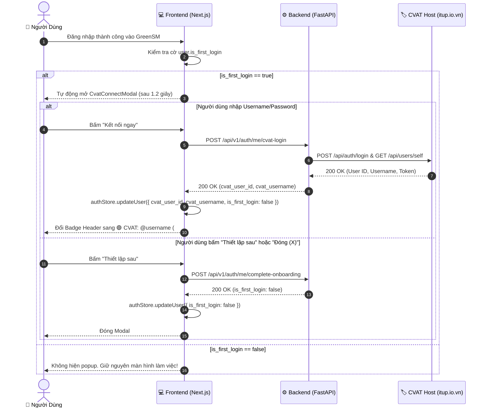

# 📋 TÀI LIỆU ĐẶC TẢ KỸ THUẬT: API ONBOARDING & KẾT NỐI CVAT TRỰC TIẾP
> **Dự án**: GreenSM MLOps Platform — VinFast Hackathon  
> **Dành cho**: Backend & Frontend Engineering Team  
> **Phiên bản API**: v1.0.0 (FastAPI 3.0.0)  
> **Trạng thái**: Production Ready — Đã kiểm thử 100%

---

## 🎯 1. Bối cảnh & Nguyên lý Vận hành

### 1.1. Mục tiêu
- Khi người dùng đăng nhập lần đầu vào GreenSM (`user.is_first_login == true`), hệ thống tự động kích hoạt trải nghiệm **Onboarding** để người dùng liên kết tài khoản dán nhãn trên kho lưu trữ tập trung **CVAT (`https://cvat.itup.io.vn/`)**.
- Sau khi người dùng hoàn thành liên kết HOẶC bấm bỏ qua ("Thiết lập sau"), cờ `is_first_login` được cập nhật thành `false` trong PostgreSQL. Kể từ các lần đăng nhập tiếp theo, popup Onboarding **tuyệt đối không bao giờ xuất hiện làm phiền người dùng nữa**.

---

## 🌐 2. Danh mục API Endpoints

Hệ thống cung cấp **4 API chuẩn RESTful** tại prefix `/api/v1/auth/me`:

```text
GET    /api/v1/auth/me/first-login-status   --> [GET CHUYÊN BIỆT] Kiểm tra đây có phải lần đầu đăng nhập không
POST   /api/v1/auth/me/cvat-login           --> Đăng nhập tài khoản/mật khẩu CVAT (Khuyên dùng)
PUT    /api/v1/auth/me/cvat-token           --> Nhập Personal Access Token (PAT) thủ công
POST   /api/v1/auth/me/complete-onboarding  --> Đánh dấu hoàn tất Onboarding (is_first_login = false)
DELETE /api/v1/auth/me/cvat-token           --> Hủy liên kết CVAT Host
```

---

## 📡 3. Chi tiết Hợp đồng API (API Contract)

### 🔹 API 1: Kiểm tra trạng thái đăng nhập lần đầu (`GET /api/v1/auth/me/first-login-status`)
Dùng để Frontend gọi độc lập kiểm tra xem tài khoản hiện tại có phải đăng nhập lần đầu hay không, nhằm quyết định kích hoạt luồng chào mừng / Onboarding modal.

- **Phương thức**: `GET`
- **Đường dẫn**: `/api/v1/auth/me/first-login-status`
- **Headers**:
  ```http
  Authorization: Bearer <JWT_ACCESS_TOKEN>
  Accept: application/json
  ```
- **Input (Request Parameters / Body)**:
  - *Không có body (None/Empty)*.
  - Người dùng được xác thực tự động thông qua Access Token trong header `Authorization`.

- **Output Thành công (HTTP 200 OK)**:
  ```json
  {
    "success": true,
    "message": "Lấy trạng thái đăng nhập đầu tiên thành công",
    "data": {
      "is_first_login": true,
      "cvat_connected": false,
      "cvat_user_id": null,
      "cvat_username": null,
      "requires_onboarding": true
    },
    "error_code": null,
    "detail": null,
    "timestamp": "2026-10-14T08:35:12.123456"
  }
  ```
  | Trường trong `data` | Kiểu dữ liệu | Ý nghĩa cho Frontend |
  | :--- | :---: | :--- |
  | `is_first_login` | `boolean` | `true` nếu người dùng chưa từng hoàn tất onboarding; `false` nếu đã từng đăng nhập trước đó. |
  | `cvat_connected` | `boolean` | `true` nếu người dùng đã liên kết tài khoản CVAT; `false` nếu chưa. |
  | `cvat_user_id` | `integer \| null` | ID tài khoản người dùng trên CVAT Host. |
  | `cvat_username` | `string \| null` | Tên tài khoản trên CVAT Host. |
  | `requires_onboarding` | `boolean` | **Cờ quyết định trực tiếp cho FE**: `true` khi `is_first_login === true && !cvat_connected`. FE chỉ cần `if (data.requires_onboarding) openModal()`. |

- **Output Lỗi (HTTP 401 Unauthorized)**:
  Nếu Token hết hạn hoặc không hợp lệ:
  ```json
  {
    "detail": "Không thể xác thực thông tin đăng nhập hoặc phiên làm việc đã hết hạn."
  }
  ```

---

### 🔹 API 2: Đăng nhập tài khoản CVAT (`POST /api/v1/auth/me/cvat-login`)
Dùng khi người dùng nhập **Username & Password** của tài khoản trên `https://cvat.itup.io.vn/`.

- **Headers**:
  ```http
  Authorization: Bearer <JWT_ACCESS_TOKEN>
  Content-Type: application/json
  Accept: application/json
  ```
- **Input (Request Body)**:
  ```json
  {
    "username": "hoa_cvat",
    "password": "PasswordSecret123!"
  }
  ```
  | Trường | Kiểu dữ liệu | Bắt buộc | Mô tả |
  | :--- | :--- | :---: | :--- |
  | `username` | `string` | **Có** | Tên đăng nhập trên `cvat.itup.io.vn` (tối thiểu 1 ký tự). |
  | `password` | `string` | **Có** | Mật khẩu tài khoản CVAT. |

- **Output Thành công (HTTP 200 OK)**:
  ```json
  {
    "success": true,
    "message": "Liên kết thành công với tài khoản CVAT: hoa_cvat (#14)",
    "data": {
      "cvat_user_id": 14,
      "cvat_username": "hoa_cvat",
      "message": "Liên kết tài khoản CVAT thành công"
    },
    "error_code": null,
    "detail": null,
    "timestamp": "2026-10-14T08:35:12.123456"
  }
  ```
  > **Tác động phía Backend**: Tự động gán `user.is_first_login = false`, `user.cvat_token = "..."`, `user.cvat_user_id = 14`, `user.cvat_username = "hoa_cvat"`. Mật khẩu bị hủy ngay khỏi RAM.

- **Output Thất bại (HTTP 400 Bad Request)**:
  ```json
  {
    "success": false,
    "message": "Tài khoản hoặc mật khẩu trên máy chủ CVAT (https://cvat.itup.io.vn) không chính xác.",
    "data": null,
    "error_code": "BAD_REQUEST",
    "detail": "Tài khoản hoặc mật khẩu trên máy chủ CVAT (https://cvat.itup.io.vn) không chính xác.",
    "timestamp": "2026-10-14T08:35:15.654321"
  }
  ```

---

### 🔹 API 3: Cài đặt Token PAT CVAT (`PUT /api/v1/auth/me/cvat-token`)
Dành cho người dùng nâng cao muốn dán trực tiếp mã Personal Access Token được sinh từ CVAT.

- **Headers**:
  ```http
  Authorization: Bearer <JWT_ACCESS_TOKEN>
  Content-Type: application/json
  ```
- **Input (Request Body)**:
  ```json
  {
    "cvat_token": "a1b2c3d4e5f67890123456789abcdef012345678"
  }
  ```
- **Output Thành công (HTTP 200 OK)**:
  ```json
  {
    "success": true,
    "message": "Liên kết tài khoản CVAT thành công",
    "data": {
      "cvat_user_id": 14,
      "cvat_username": "hoa_cvat",
      "message": "Liên kết tài khoản CVAT thành công"
    }
  }
  ```

---

### 🔹 API 4: Hoàn tất Onboarding (`POST /api/v1/auth/me/complete-onboarding`)
Dùng khi người dùng bấm **"Thiết lập sau"**, bấm nút **"X (Đóng modal)"**, hoặc hoàn tất bất kỳ bước chào mừng nào.

- **Headers**:
  ```http
  Authorization: Bearer <JWT_ACCESS_TOKEN>
  ```
- **Input**: Không cần body (`{}`).
- **Output Thành công (HTTP 200 OK)**:
  ```json
  {
    "success": true,
    "message": "Đã hoàn tất quá trình thiết lập ban đầu thành công",
    "data": {
      "id": "2cdd1645-716e-40ec-8a93-64f1dedfbf74",
      "email": "annotator@greensm.vn",
      "full_name": "Nguyễn Thị Hoa",
      "avatar_url": null,
      "title": "Senior Annotator",
      "total_annotated": 0,
      "accuracy_rate": 1.0,
      "is_admin": false,
      "is_active": true,
      "cvat_user_id": null,
      "cvat_username": null,
      "is_first_login": false,
      "last_login_at": "2026-10-14T08:38:25.444799Z"
    }
  }
  ```

---

## 🎨 4. Hướng dẫn Quy chuẩn Dành cho Frontend (FE Requirements)



### 📋 Checklist Triển khai cho Frontend:

1. **Quản lý State (`useAuthStore`)**:
   - Khi nhận `user` từ API `login` hoặc `getMe()`, lưu trường `is_first_login: boolean` vào store và LocalStorage.
   - Luôn sử dụng `user.is_first_login` làm điều kiện quyết định việc mở Modal Onboarding.
2. **Kích hoạt Modal (`AppHeader.tsx`)**:
   ```typescript
   useEffect(() => {
     if (user && user.is_first_login) {
       const timer = setTimeout(() => {
         setCvatModalOpen(true);
       }, 1200);
       return () => clearTimeout(timer);
     }
   }, [user]);
   ```
3. **Sự kiện Đóng Modal (`onClose`)**:
   - Khi đóng modal, nếu `user.is_first_login === true`:
     Gọi ngay `authApi.completeOnboarding()` và `updateUser({ is_first_login: false })`.
     *(Đảm bảo không bao giờ hiện lại ở các phiên sau)*.
4. **Huy hiệu Header Badge**:
   - **Đã kết nối**: Badge xanh lục `🟢 CVAT: @{user.cvat_username} (#{user.cvat_user_id})`. Bấm vào mở modal kèm nút *"Mở CVAT Workspace"* (`window.open('https://cvat.itup.io.vn', '_blank')`).
   - **Chưa kết nối**: Badge màu hổ phách/cam `🏷️ Liên kết CVAT`.
